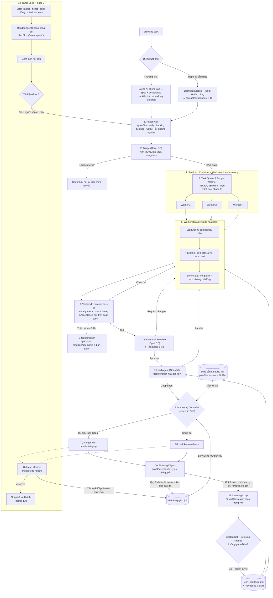

# Proofline (v1.5)

> **Xưởng phần mềm nơi mọi thay đổi đều có bằng chứng.**  
> Một đội AI agent làm việc song song (kể cả xuyên đêm), mỗi thay đổi đi kèm chứng minh ở ba lớp: code, người dùng, production; quyền tự chủ được kiếm dần bằng số liệu.  
> Kết hợp mô hình thực chiến **Lauren Tan (30+ Autonomous Agents / `pstack`)** và nền tảng lý thuyết **Google Research Harness² (Recursive Agent Harnessing)**.

---

## 1. Giới thiệu tổng quan

**Proofline** là lớp **điều phối, kiểm chứng và tự chủ** bao quanh các AI coding agent có sẵn (Claude Code headless / Claude Agent SDK). Hệ thống tiếp nhận việc, phân phối cho nhiều worker chạy song song trong sandbox cách ly, tự kiểm chứng kết quả **như một người dùng thật**, ra quyết định theo **gu của Tech Lead**, và được **tự quyết nhiều hơn khi đã chứng minh được bằng số liệu**.

Điểm khác biệt không nằm ở việc "agent viết code", mà ở: **ưu tiên kiểm chứng, tự host cho code nội bộ, gu và playbook riêng của tổ chức được cải tiến có đo lường, và quyền tự chủ được kiếm dần chứ không bật sẵn**.

### 9 Trụ cột giá trị (v1.5):
1. **Bắt đầu dễ, từ hai điểm xuất phát:** `proofline start` tự nhận biết bạn bắt đầu **từ ý tưởng** (luồng A: phỏng vấn → spec có acceptance journey → kiến trúc → walking skeleton) hay **từ repo có sẵn** (luồng B: `proofline assess` → kiểm kê tính năng → khóa hành vi bằng test). Repo được đưa qua các **mức sẵn sàng R0–R4**; quyền tự chủ không bao giờ vượt quá mức sẵn sàng.
2. **Golden Set & Decision Replay Set:** Một bộ đo năng lực giải bài (bug lịch sử, bug cấy synthetic khi lịch sử còn ít, và việc đã xử lý tích lũy dần; đều có test ẩn), một bộ đo độ giống người khi ra quyết định (PR lịch sử + quyết định thật). Mọi thay đổi model, harness, playbook, taste đều phải chạy lại.
3. **Model Tiering theo vai trò (không cố định model):** Mặc định tạm thời: Haiku 5.5 cho triage và tác vụ nhanh, Sonnet 5.5 cho viết code, Opus 5.5 cho review và Lead Agent. Đổi qua config, override theo repo hoặc biến môi trường.
4. **Verification do harness thực thi:** Test tái hiện phải fail đúng ở assertion trên commit gốc và pass sau khi sửa; không sửa/skip test cũ; không regression; không tăng cảnh báo lint/type.
5. **User Journey & Acceptance Verification:** Test xanh chưa đủ. Agent tự khởi chạy app trong sandbox và đi hết luồng người dùng (API, CLI, giao diện); kịch bản phải fail trên bản lỗi và pass sau khi sửa. Với tính năng mới, acceptance journey được người duyệt trước trong spec và agent không được sửa.
6. **Adversarial Reviewer & Risk Score:** Agent thứ hai audit diff và kịch bản người dùng; mỗi PR có điểm rủi ro 0–10 tính bằng code xác định.
7. **Lead Agent & gu Tech Lead:** Gu được khởi tạo bằng phỏng vấn ngay ngày đầu; Lead Agent đặt câu hỏi Tech Lead sẽ hỏi, quyết định "good enough" hay làm lại; học tiếp từ chỉnh sửa, comment và lý do từ chối của người vào `tech-lead-taste.md`, có kiểm chứng.
8. **Bậc thang tự chủ:** Cấp 1 Draft PR → Cấp 2 tự merge việc rủi ro thấp vào `develop`/`staging` → Cấp 3 tự tìm việc và tự xử lý CI fail/lỗi staging. Lên cấp khi quyết định của agent đã trùng với người và kết quả thực tế tốt; tự hạ cấp khi có sự cố.
9. **Outer Loop:** Lắng nghe error tracker, ticket hỗ trợ, kênh cộng đồng và thảo luận của team; gom cụm nỗi đau, **tái hiện trước khi thành issue**, đo tần suất lỗi và phàn nàn trước/sau release để biết vấn đề đã thật sự được giải quyết chưa. Nội dung bên ngoài luôn là dữ liệu không đáng tin, dữ liệu cá nhân được che, và tin nhắn gửi khách luôn do người gửi.

---

## 2. Cấu trúc thư mục dự án

```
Proofline/
├── README.md                          # Tổng quan dự án & Chỉ dẫn điều hướng
├── docs/
│   ├── 01-research-harness2.md        # Nghiên cứu Google Research Harness²
│   ├── 02-research-lauren-tan-swarm.md# Kiến trúc Swarm & Verification của Lauren Tan
│   ├── 03-system-architecture.md      # Thiết kế kiến trúc kỹ thuật v1.5
│   ├── 04-execution-plan.md           # Kế hoạch thực thi 8 giai đoạn (Phase 0–7)
│   ├── 05-starting-points.md          # Hai điểm xuất phát & mức sẵn sàng R0–R4
│   └── 06-the-outer-loop.md           # Outer Loop: khách hàng, team, telemetry production
├── config/
│   └── proofline.yaml                 # Repo đích, onboarding, mức sẵn sàng, sandbox, model, gate, taste, autonomy
├── playbooks/                         # Thư viện quy tắc, gu & kỹ năng
│   ├── guardrails.md                  # Chốt an toàn (được thực thi thêm ở tầng hạ tầng)
│   ├── tech-lead-taste.md             # Gu Tech Lead, cập nhật có kiểm chứng
│   └── skills/
│       └── bug-fix-playbook.md        # Quy trình chuẩn xử lý bug
├── evals/                             # (dự kiến, Phase 0)
│   ├── golden-set/                    # Mỗi case: issue.md, case.yaml (source), hidden_tests/
│   ├── decision-replay/               # PR lịch sử + quyết định thật của người
│   └── reports/                       # Báo cáo baseline & so sánh
├── src/proofline/                     # Mã nguồn
│   ├── cli.py                         # Lệnh `proofline`
│   ├── config.py                      # Đọc/kiểm tra config, chọn model theo vai trò
│   ├── autonomy.py                    # Mức tự chủ hiệu lực (max, mức sẵn sàng, kill switch)
│   ├── levels.py                      # Thang L0–L4 và R0–R4
│   └── state/                         # SQLite state/proofline.db + schema.sql
│                                      # (dự kiến) start, assess, interview, init, eval_runner, worker, sandbox,
│                                      #           verifier, journey_runner, dispatcher, decision_log
└── tests/
```

---

## Phát triển

Cần [uv](https://docs.astral.sh/uv/) và Python ≥ 3.11.

```bash
uv sync
```

```bash
uv run pytest -q
```

```bash
uv run ruff check . && uv run ruff format --check .
```

Các lệnh đã có:

| Lệnh | Việc làm |
| :--- | :--- |
| `proofline --version` | In phiên bản |
| `proofline config check` | Kiểm tra `config/proofline.yaml` hợp lệ |
| `proofline config model <vai_trò> [--repo <tên>]` | Model sẽ dùng cho vai trò (ưu tiên: `PROOFLINE_MODEL_<VAI_TRÒ>` → override theo repo → mặc định) |
| `proofline autonomy show --readiness <R0–R4>` | Mức tự chủ hiệu lực của mọi loại quyết định |
| `proofline db init [--path <file>]` | Tạo `state/proofline.db` và áp schema |

Chạy lệnh trong môi trường dự án bằng `uv run proofline ...`.

---

## 3. Kiến trúc luồng hoạt động



---

## 4. Tài liệu liên kết (Quick Links)

* Nghiên cứu Harness²: [01-research-harness2.md](docs/01-research-harness2.md)
* Case study Lauren Tan: [02-research-lauren-tan-swarm.md](docs/02-research-lauren-tan-swarm.md)
* Thiết kế kiến trúc hệ thống v1.5: [03-system-architecture.md](docs/03-system-architecture.md)
* Lộ trình triển khai 8 giai đoạn: [04-execution-plan.md](docs/04-execution-plan.md)
* Hai điểm xuất phát & mức sẵn sàng: [05-starting-points.md](docs/05-starting-points.md)
* Outer Loop: [06-the-outer-loop.md](docs/06-the-outer-loop.md)
* Cấu hình: [proofline.yaml](config/proofline.yaml)
* Chốt an toàn: [guardrails.md](playbooks/guardrails.md)
* Gu Tech Lead: [tech-lead-taste.md](playbooks/tech-lead-taste.md)
