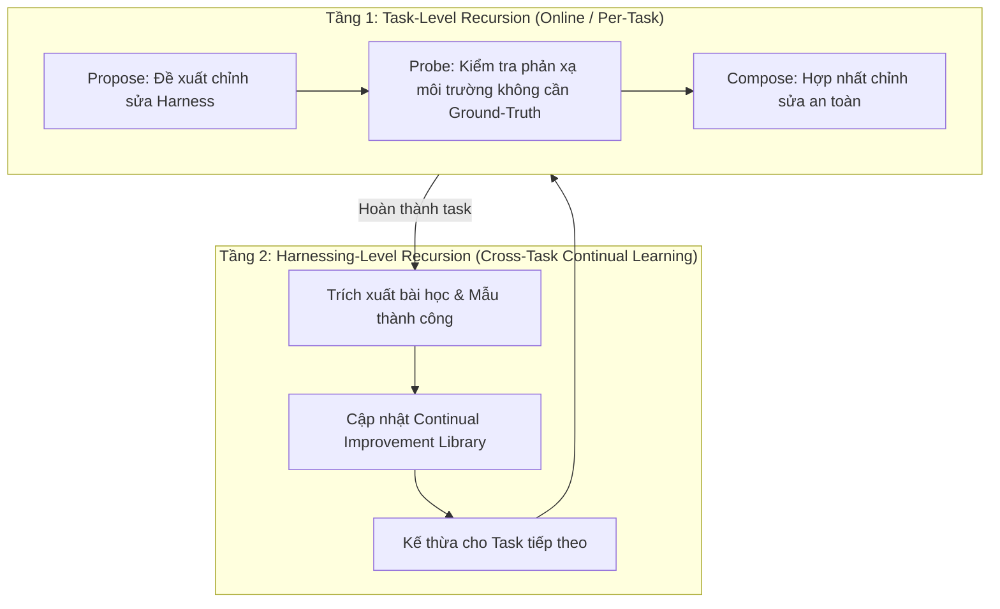

# Nghiên cứu chuyên sâu: Google Research Harness²

> **Tên bài báo:** *Harness²: Recursive Agent Harnessing for an Open World*  
> **Nhóm tác giả:** Ruiyao Xu, Yanfei Chen, Zhongying CuiZhu, Bhavana Dalvi Mishra, Yifei Ming, Han Yu, Rujun Han, Chen-Yu Lee, Tomas Pfister (Google Cloud AI Research)  
> **Mã arXiv:** [arXiv:2610.14224](https://arxiv.org/abs/2610.14224) | **Source Repo:** [google-research/harness2](https://github.com/google-research/harness2)

---

## 1. Bối cảnh & Vấn đề giải quyết

Trong kỷ nguyên Agentic AI, hiệu năng của một Agent phụ thuộc rất lớn vào **Harness** (toàn bộ môi trường bao bọc xung quanh mô hình: system prompts, công cụ, hướng dẫn sử dụng công cụ, bộ nhớ, guardrails, scripts trợ lực).

Tuy nhiên, việc tối ưu Harness đang đối mặt với 2 rào cản lớn trong môi trường thực tế (Open-World):
1. **Thiếu Verifier ở Test-time:** Khi agent đối mặt với task mới chưa từng thấy, môi trường thường **không có sẵn ground-truth label** hoặc test suite để agent biết mình làm đúng hay sai.
2. **Kém khái quát (Hyper-task-specific):** Các phương pháp tự sửa đổi thông thường chỉ sửa tạm thời cho task hiện tại mà không biến kinh nghiệm đó thành kỹ năng dùng lại được cho các task sau.

---

## 2. Giải pháp của Harness²: Dual-Level Recursion

Harness² giải quyết bài toán trên bằng cách **đóng băng hoàn toàn trọng số mô hình (Frozen Model Weights)** và triển khai **2 tầng đệ quy tự hoàn thiện (Dual-Level Recursion)**.

### 2.1. Tầng 1: Task-Level Recursion (Propose – Probe – Compose)
* **Propose:** Phân tích yêu cầu bài toán và bối cảnh mã nguồn, đề xuất điều chỉnh harness (vd: viết một helper script kiểm tra cú pháp, thêm instruction vào prompt, tạo subagent phụ).
* **Probe (Contrastive Probing):** Chạy thử nghiệm đối chứng trong môi trường sandbox để đo lường độ ổn định và tính khả thi mà **không cần ground-truth label**. Kỹ thuật này phát hiện sớm các lỗi cú pháp, xung đột runtime hoặc ảo giác của LLM.
* **Compose:** Ghép những thay đổi vượt qua bước Probe vào harness chính thức để thực thi giải quyết task.

### 2.2. Tầng 2: Harnessing-Level Recursion (Continual Library)
* Khi task kết thúc thành công, hệ thống tự kích hoạt bước **Reflection**:
  - Những công cụ nào viết ra có tính tái sử dụng?
  - Quy tắc nào đã giúp agent tránh lỗi lặp lại?
* Các kết quả này được chuẩn hóa thành tệp markdown/script và lưu vào thư viện tri thức chung (`Continual Improvement Library`).

---

## 3. 8 Thành phần Harness được mô đun hóa dạng File (File-Mounted Components)

Harness² thiết kế toàn bộ hạ tầng điều khiển thành 8 tệp/thư mục có thể đọc và sửa đổi trực tiếp:

| STT | Thành phần | Mô tả kỹ thuật |
| :--- | :--- | :--- |
| 1 | **System Prompt** | Persona, phong cách tư duy, thứ tự ưu tiên xử lý. |
| 2 | **Guardrails** | Các chốt chặn an toàn (vd: cấm force push, cấm xóa file cấu hình gốc, giới hạn số bước lặp). |
| 3 | **Memory** | Bộ nhớ ngắn hạn (theo task) và dài hạn (semantic cache, episodic memory). |
| 4 | **Tool Guidance** | Tài liệu hướng dẫn agent khi nào nên và không nên gọi từng công cụ cụ thể. |
| 5 | **Subagents** | Khai báo các agent con chuyên biệt (vd: reviewer, migration specialist, linter fixer). |
| 6 | **Skills** | Quy trình thực hiện task từng bước (playbooks/SOPs). |
| 7 | **Scripts** | Các file mã Python/Bash bổ trợ do agent tự viết ra để tự chạy trong môi trường. |
| 8 | **Middleware Plugins** | Các hook can thiệp vào trước và sau khi gọi model/tool để lọc dữ liệu hoặc log. |

---

## 4. Kết quả thực nghiệm

Trên các benchmark phức tạp mô phỏng môi trường làm việc thực tế của kỹ sư phần mềm:
* **WorkBuddy-Bench, JobBench, LAB:** Cải thiện trực tiếp từ **+4 đến +11 điểm %** tỷ lệ hoàn thành tác vụ thành công.
* Toàn bộ cải tiến đạt được mà **không cần bất kỳ GPU training hay fine-tune nào**, chỉ thuần túy tối ưu cấu trúc Harness.

---

## 5. Đối chiếu với mã nguồn và với Proofline

Đọc mã nguồn [google-research/harness2](https://github.com/google-research/harness2) (commit `1cfe254`, Apache 2.0). Proofline **không dùng code hay thư viện** của Harness²; chỉ lấy ý tưởng.

### 5.1. Điểm cần chỉnh so với phần tóm tắt ở trên
* Đây là khung **nghiên cứu cho benchmark** (JobBench, LAB, WorkBuddy), không phải công cụ dùng trên repo thật. Agent thực thi chỉ có **OpenCode và Codex**; model mặc định qua Vertex AI; cần **Python ≥ 3.12, chỉ POSIX**. Codex chạy với sandbox tắt, mạng không giới hạn.
* Không có đáp án chuẩn: bước chọn harness tốt nhất do **một LLM chọn** trong các kết quả đã ẩn danh; điểm của bộ chấm chỉ dùng để đo **sau khi** đã chọn, không bao giờ quay lại phương pháp. Vì vậy Tầng 2 không "kích hoạt khi task thành công" (hệ thống không biết task thành công hay không).
* Ngân sách mỗi task: **4k lần chạy agent + 3k phiên cải tiến** (k=1: 4 + 3).
* Thư viện kinh nghiệm chia **theo domain** (`<domain>/harnesses/<task>/harness/` + `EXPERIENCE.md` + `INDEX.md`), lưu **nguyên cây harness** chứ không tóm tắt, được **tự áp dụng** cho task sau cùng domain, và **bắt đầu trống ở mỗi lượt chạy** (không phải kho tri thức lâu dài).

### 5.2. Chỗ đụng với kế hoạch Proofline
| Harness² | Proofline | Cách giữ |
| :--- | :--- | :--- |
| Tự áp dụng harness và bài học cho task sau, không qua bộ đo, không qua người | Mọi thay đổi harness/playbook/taste phải qua Golden Set và người duyệt (`harness_learning.require_*`) | Giữ cách của Proofline; kho tri thức theo domain thiết kế lại ở [08-domain-knowledge.md](08-domain-knowledge.md) |
| Chọn bản tốt nhất bằng LLM, không đáp án | Có gate thật: journey fail trên base → pass, test, hidden tests | Dùng gate làm bộ chọn, LLM chỉ để giải thích |
| Vòng trong chạy cho **mỗi task** (≥ 4 lần chạy) | Ngân sách theo ngày, một worker mỗi issue | Chỉ chạy kiểu Propose–Probe–Compose **offline trên Golden Set** (Phase 5), không chạy cho mọi issue |
| 8 thành phần là file do Harness² quản | Worker nạp guardrails, taste, playbook; PandaCode cũng ghi skill/rule vào `.claude/`, `CLAUDE.md` | Worker cô lập, harness có dấu vân tay ([03](03-system-architecture.md) mục 2.1, 2.5; [07](07-acp-pandacode.md) mục 4.4) |

### 5.3. Ý tưởng mượn
1. **Dấu vân tay harness** và đánh dấu lần chạy đã xong kèm cấu hình (`core/runmark.py`) → `harness_version`, resume eval.
2. **Kiểm tra rò rỉ** (`assert_no_leak_paths`, `assert_no_grader_verdicts` trong `core/context.py`) → ngữ cảnh của worker không chứa `hidden_tests`.
3. **Bộ chấm tách khỏi phương pháp**, lỗi chấm là `None` chứ không phải 0 (`core/judge.py`); Proofline đã có trạng thái `unknown`.
4. **Bằng chứng dạng cây file** cho agent đề xuất (`core/context.py`: task, trajectory, kết quả, harness, thư viện) thay vì nhồi vào prompt.
5. **Giao diện `BenchmarkAdapter`** (danh sách task, chạy, kết quả, chấm sau khi chọn) làm mẫu cho `eval_runner`.
6. **Thư viện theo domain, lấy theo cấu trúc thư mục** → kho tri thức theo domain của Proofline (docs/08).

Chép code của Harness² thì phải giữ ghi chú giấy phép Apache 2.0.
