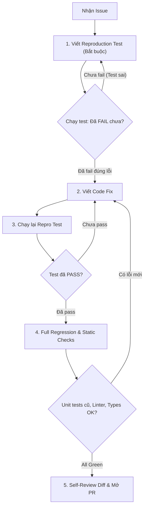

# Nghiên cứu thực chiến: Lauren Tan Swarm & `pstack`

> **Chủ đề:** *How 30+ AI Agents Ship PRs While You Sleep*  
> **Diễn giả:** Lauren Tan (*poteto* - cựu Staff Engineer tại Meta, Cursor, xAI/SpaceX)  
> **Nguồn video:** [YouTube: 6hxp0SpGxz8](https://www.youtube.com/watch?v=6hxp0SpGxz8) | **Công cụ nổi bật:** `pstack` (Playbook Stack for Agents)

---

## 1. Triết lý: Chuyển dịch từ "Viết Code" sang "Điều khiển Agent"

Lauren Tan đưa ra một khẳng định mang tính bước ngoặt:
> *"Trong kỷ nguyên AI Agent, vai trò của kỹ sư phần mềm không còn là ngồi gõ từng dòng lệnh cú pháp, mà trở thành Giám đốc Kỹ thuật (Director/Tech Lead): thiết lập ranh giới, định nghĩa tiêu chuẩn nghiệm thu và chỉ huy một đội ngũ Agent tự động."*

Một kỹ sư duy nhất có thể vận hành **20 đến 30+ Agent chạy song song xuyên đêm**, giải quyết hàng chục PRs và merge hàng ngàn commit mỗi tháng nếu tuân thủ đúng phương pháp luận.

---

## 2. Bí quyết thành công: Verification Loop (Vòng lặp thẩm định)

Vấn đề số 1 khiến hầu hết các dự án dùng AI thất bại là **"Hallucination Merge"** (code nhìn có vẻ đúng nhưng chạy thực tế thì hỏng, hoặc phá vỡ các phần khác).

Theo Lauren Tan: **Chìa khóa để ship hàng ngàn PRs an toàn không phải là model thông minh hơn, mà là cơ chế thẩm định khắt khe (Rigorous Verification).**

### 4 Chốt chặn thẩm định (Verification Gates):
1. **Reproduction Test:** Agent không được phép bắt đầu sửa code nếu chưa viết được 1 test case tái hiện được đúng bug (phải chạy test và thấy đỏ/fail).
2. **Target Fix Verification:** Khi sửa code xong, test case tái hiện đó phải chuyển sang xanh (pass).
3. **No Regression:** Toàn bộ test suite cũ của dự án không được phát sinh bất kỳ lỗi nào mới.
4. **Clean Diff & Zero Warning:** Linter, Formatter, Typechecker không được sinh ra cảnh báo hay format lệch so với codebase chung.

---

## 3. Bản chất của `pstack`

Lauren Tan xây dựng bộ công cụ mang tên **`pstack`** (Playbook Stack). Đây là tập hợp các chỉ dẫn kỹ thuật có tính định kiến cao (opinionated SOPs/playbooks) được nạp trực tiếp vào harness của Agent:
* Không để agent tự do suy diễn lung tung: Khi nhận lệnh `/fix-bug`, agent bị ép phải làm theo quy trình: `Tái hiện -> Khoanh vùng root cause -> Sửa tối giản -> Test -> Báo cáo`.
* Khi nhận lệnh `/refactor`, agent bị cấm đổi behavior, chỉ được đổi cấu trúc và giữ nguyên test specs.
* Khi chạy batch qua đêm (`/loop`, `/swarm`), agent chỉ được phép dừng khi vượt qua toàn bộ verification gates hoặc hết budget token/thời gian.

---

## 4. Cách ly môi trường thực thi (Workspace Isolation)

Để 30+ Agent chạy cùng lúc trên 1 repo lớn mà không xung đột:
* **Sử dụng Git Worktrees:** Mỗi Agent sở hữu một thư mục làm việc vật lý riêng biệt (`git worktree add ../agent-task-123 branch-name`). Các agent không bao giờ đè lên file của nhau.
* **Ephemeral Sandboxes / Cloud Agents:** Chạy các agent trên các worker độc lập có gắn kèm database test cô lập. Khi hoàn thành, worker tự push branch, mở PR rồi dọn dẹp sạch worktree.

---

## 5. Kết luận & Điểm chạm với Harness²

| Khía cạnh | Lauren Tan (`pstack`) | Google Research (`Harness²`) |
| :--- | :--- | :--- |
| **Cách tiếp cận** | Thực chiến kỹ thuật phần mềm (Engineering Practice) | Nghiên cứu khoa học máy tính (Scientific CS Paper) |
| **Trọng tâm** | Verification Loop, Git Worktree, Parallel Swarms | Dual-Level Recursion, Contrastive Probing |
| **Hạn chế** | Playbooks phải do con người tự viết tay và cập nhật | Cần môi trường thực chiến phần mềm cụ thể |
| **Khi kết hợp** | **Agent vừa tuân thủ kỷ luật kỹ thuật (Lauren Tan), vừa tự tiến hóa bộ playbook (Harness²)** |
