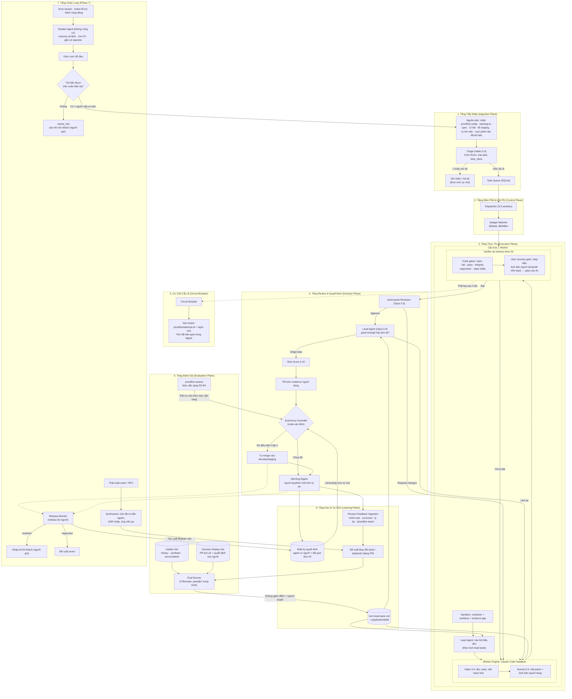

# Thiết kế kiến trúc kỹ thuật Proofline v1.5

> Tài liệu mô tả kiến trúc tầng, các khối thành phần, luồng dữ liệu, cơ chế phân tầng mô hình, kiểm chứng như người dùng thật, học "gu" Tech Lead, mức sẵn sàng của repo, bậc thang tự chủ và Outer Loop của hệ thống **Proofline**. Cấu hình tương ứng: [proofline.yaml](../src/proofline/templates/proofline.yaml). Lộ trình triển khai: [04-execution-plan.md](04-execution-plan.md). Hai điểm xuất phát: [05-starting-points.md](05-starting-points.md). Outer Loop: [06-the-outer-loop.md](06-the-outer-loop.md).

---

## 1. Sơ đồ khối kiến trúc



---

## 2. Chi tiết các thành phần

### 2.1. Golden Set, Decision Replay Set & Eval Runner (Tầng đánh giá)
* **Mục đích:** Có thước đo khách quan cho mọi thay đổi: model, harness, playbook, taste, cấu hình gate.
* **Golden Set** đo *năng lực giải bài*. Cấu trúc mỗi case (`evals/golden-set/<case-id>/`):
  - `issue.md`: mô tả bug từ issue gốc, đã xóa gợi ý lời giải.
  - `case.yaml`: `base_commit`, lệnh test, kích thước, loại task.
  - `hidden_tests/`: test từ commit sửa gốc; agent không được thấy, chỉ dùng để chấm.
* **Ba nguồn case:** `history` (bug thật, `proofline golden mine`), `synthetic` (cấy lỗi vào code có test bao phủ, `proofline golden synth`, tối đa 70%), `accumulated` (việc thật đã xử lý qua Proofline, gồm cả feature). pass@1 được báo cáo riêng theo nguồn; chỉ số chính dùng nguồn thật khi đã có ≥ 15 case thật. Chi tiết ở [05-starting-points.md](05-starting-points.md) mục 8.
* **Chọn case lịch sử:** phần sửa < 100 dòng, có test đi kèm, không cần mock hệ thống ngoài phức tạp, test tất định; phân bố khoảng 60% S / 30% M / 10% L. `proofline golden mine` đề xuất ứng viên, người chọn.
* **Decision Replay Set** (`evals/decision-replay/`) đo *độ giống người khi ra quyết định*: PR lịch sử kèm quyết định thật của người (merge nguyên trạng / yêu cầu sửa / đóng) và lý do. Dùng để kiểm chứng Lead Agent và mọi thay đổi của `tech-lead-taste.md`.
* **Cách chấm:** giải đúng = `hidden_tests` pass + toàn bộ test suite không regression. Mỗi case chạy 3 lần vì agent không tất định. Chỉ số chính là **pass@1 trung bình**; **pass@3** chỉ là cận trên.
* **Dấu vân tay harness:** `harness_version` không chỉ là Git SHA của Proofline mà là digest của **toàn bộ harness thực tế worker đã nạp** (guardrails, taste, playbook, kho tri thức, cấu hình model). Một lần chạy chỉ được dùng lại khi trùng dấu vân tay (ý tưởng `runmark` của Harness²), nên resume eval không lẫn kết quả của cấu hình khác.
* **Chống rò rỉ đáp án:** trước khi giao việc, eval runner kiểm tra ngữ cảnh đưa cho worker không chứa `hidden_tests`, đường dẫn hay nội dung của chúng; bộ chấm lỗi thì kết quả là `unknown`, không tính là 0.
* **Lưu trữ:** mọi lần chạy ghi vào `state/proofline.db` (bảng `runs`, `tasks`, `decisions`, `readiness_snapshots`; schema ở [04-execution-plan.md](04-execution-plan.md)), dùng chung cho eval, shadow và production.

### 2.2. Điểm xuất phát & mức sẵn sàng của repo
* **`proofline start`** là cửa vào duy nhất: repo trống hoặc chỉ có tài liệu ý tưởng → **luồng A** (vào ở R0); repo đã có code → **luồng B** (vào ở R1). Từ R1 trở đi hai luồng đi chung.
* **`proofline assess`** đo mức sẵn sàng tự động, chạy lại mỗi đêm, lưu vào `readiness_snapshots`:

| Mức | Tiêu chí chính | Trần tự chủ |
| :--- | :--- | :--- |
| R0 – Ý tưởng | Chưa có code chạy được | Mọi bước có người duyệt |
| R1 – Chạy được | App khởi chạy và qua healthcheck trong sandbox; test chạy được | Cấp 1, chỉ `characterization` và `ci_setup` |
| R2 – Kiểm chứng được | Tính năng đã kiểm kê và được xác nhận; ≥ 80% có kịch bản người dùng; CI xanh | Cấp 1; `add_tests` được xét Cấp 2 |
| R3 – Có bộ đo | Test hồi quy cho mọi tính năng; Golden Set ≥ 30 case; có baseline | Được xét Cấp 2 |
| R4 – Có lịch sử | Decision Replay Set ≥ 30 PR; ≥ 50 quyết định của người cho mỗi loại cần xét | Được xét Cấp 3 |

* Mức sẵn sàng **có thể giảm** (CI đỏ quá 24 giờ, app không còn khởi chạy được); khi đó Autonomy Controller hạ ngay các quyết định vượt trần.
* **Luồng A:** `proofline interview` (sản phẩm + gu) → spec với acceptance journey (**người duyệt**) → ADR (**người chọn**) → walking skeleton do một worker dựng (→ R1) → cắt backlog `type:feature`.
* **Luồng B:** `proofline start <git-url>` (tạo workspace, clone, tự dò cấu hình, `assess`) + `proofline doctor` → `proofline interview` (gu) → kiểm kê tính năng ngược thành `.proofline/features.md` (**người xác nhận**; tài liệu có sẵn của repo chỉ là nguồn đọc) → characterization test, kịch bản người dùng, CI (→ R2) → Golden Set (→ R3).
* **Shadow mode** (cả hai luồng, khi đã có code): worker làm trong sandbox, không mở PR, gửi báo cáo buổi sáng.
* Chi tiết đầy đủ ở [05-starting-points.md](05-starting-points.md).

### 2.3. Smart Triage Agent (Bộ lọc đầu vào)
* **Nguồn việc:** nhãn opt-in `proofline:ready`; ở Phase 6 thêm CI fail, lỗi staging và việc tự tìm (`self_sourced`).
* **Hoạt động:**
  - Chấm *Clarity Score (1-10)*, phân loại kích thước **S** (đổi biến/thêm check), **M** (sửa luồng logic), **L** (cần chia nhỏ, bị từ chối), loại task (bug, refactor, tech-debt) và `task_class` (vd: `typo`, `patch_bump`, `add_tests`, `lint_fix`, `logic_fix`).
  - Tự comment hỏi lại trên issue là quyết định `issue_clarify_comment` trong thang tự chủ, bắt đầu ở L1 (agent soạn sẵn, người bấm gửi).
  - Ngưỡng Clarity Score được hiệu chỉnh bằng mẫu 50 issue do người chấm.

### 2.4. Model Tiering (Phân tầng mô hình theo vai trò)
Hệ thống **không cố định model**. Code chỉ gọi model qua tên vai trò; ID model nằm trong `models.roles` của `proofline.yaml`. Bảng dưới là **mặc định tạm thời**:

| Vai trò (`models.roles`) | Model mặc định | Fallback | Dùng cho |
| :--- | :--- | :--- | :--- |
| `triage` | Claude Haiku 5.5 | — | Phân loại issue, chấm Clarity Score |
| `fast_probe` | Claude Haiku 5.5 | Sonnet 5.5 | Đọc code, viết repro test, sửa lỗi lint |
| `heavy_coding` | Claude Sonnet 5.5 | Opus 5.5 | Viết patch / code chính, kịch bản người dùng |
| `senior_reviewer` | Claude Opus 5.5 | Sonnet 5.5 | Review phản biện diff và kịch bản |
| `lead_agent` | Claude Opus 5.5 | Sonnet 5.5 | Suy luận như Tech Lead: câu hỏi đầu tiên, good enough hay làm lại, phân tích phản hồi review |

* **Thứ tự ưu tiên khi chọn model:** biến môi trường `PROOFLINE_MODEL_<VAI_TRÒ>` → `target_repos[].model_overrides` → `models.roles`.
* Đổi model mặc định được coi là thay đổi harness: phải chạy lại Golden Set (và Decision Replay Set với `lead_agent`) trước khi áp dụng.
* Bật prompt caching để giảm chi phí đọc lại ngữ cảnh. Cache gắn với từng model: đổi model giữa chừng là mất cache, nên mỗi vai trò giữ phiên riêng của mình thay vì nối tiếp hội thoại của vai trò khác (mục 2.4b).
* **Nguồn model (`worker.backend`):** mặc định là **API key tính theo token**. Gói subscription có sẵn của team (Claude/Codex plan) chỉ dùng khi bật rõ ràng và chấp nhận ba điều:
  - giới hạn lượt dùng của gói không hợp với nhiều worker chạy song song ban đêm; chạm giới hạn thì task dừng giữa chừng;
  - phải tự kiểm tra điều khoản của nhà cung cấp cho kiểu dùng tự động, nhiều tiến trình;
  - chi phí từng task **không đo được**: Budget Watcher chuyển sang giới hạn theo token, `runs.cost_usd` ghi là ước lượng, và chỉ số "chi phí / PR được merge" không còn so được với giai đoạn dùng API.
* **Một engine trước, adapter mỏng:** `worker.py` gọi agent qua một interface nhỏ (khởi chạy, gửi việc, đọc trace và chi phí, huỷ). Phase 1 chỉ làm Claude Code headless. Mỗi tổ hợp agent × model là **một harness khác**: thêm Codex hay fallback sang agent khác chỉ sau khi tổ hợp đó đã chạy Golden Set.

### 2.4b. Bàn giao giữa các vai trò bằng artifact
Các vai trò (Lead Agent, `fast_probe`, `heavy_coding`, verifier, reviewer) **không chuyển lịch sử hội thoại cho nhau**. Mỗi vai trò đọc và ghi **artifact** trong `<artifacts>/tasks/<task>/` (và nhánh của task); vai trò sau nhận các artifact đó cùng một tóm tắt ngắn, rồi tự đọc code.

| Vai trò | Artifact để lại | Harness kiểm trước khi chuyển bước |
| :--- | :--- | :--- |
| Lead Agent (trước khi sửa) | `questions.md`: câu hỏi Tech Lead sẽ hỏi, câu trả lời tìm được, dẫn nguồn (file, dòng, issue) | Có file, đúng schema, mỗi câu trả lời có nguồn |
| `fast_probe` | Test repro hoặc journey (file trên nhánh) + `repro.md` (lệnh chạy, kết quả) | Test **fail ở khẳng định** trên base (gate `acceptance_fails_before`) |
| `heavy_coding` | Commit trên nhánh + `notes.md` (quyết định đã chọn, phần chưa làm, rủi ro) | Có commit; journey/test repro không bị sửa |
| Verifier | `verify/<task>.json` | Do harness tự chạy, không phải agent |
| Reviewer, Lead Agent (sau) | `review.md`, quyết định "good enough / làm lại" trong `decisions` | Có lý do và dẫn chứng |

Vì sao:
- **Kiểm lại được:** artifact là thứ harness chạy hoặc đọc được, đúng nguyên tắc "không tin báo cáo của agent"; lịch sử chat thì không.
- **Độc lập với model:** vai trò sau có thể dùng model hoặc agent khác (fallback) mà không phải dịch lịch sử hội thoại.
- **Chạy tiếp được:** tiến trình chết hay đổi máy thì task tiếp tục từ artifact cuối cùng (giống phiên ACP lưu trong DB).
- Mỗi artifact có giới hạn độ dài; thiếu artifact hoặc sai schema thì bước sau không bắt đầu.

### 2.5. Sandbox & quyền tối thiểu
* Mỗi worker chạy trong **container riêng** (mount git worktree), có giới hạn CPU/RAM; cổng, database test, cache và **instance app cho User Journey** tách biệt giữa các worker.
* **Mạng mặc định bị chặn**, chỉ cho phép API model và registry package. Không truyền biến môi trường hay secret của máy chủ vào container.
* **GitHub App** quyền tối thiểu. Worker chỉ tạo nhánh `proofline/*` và mở PR; **chỉ Autonomy Controller được gọi merge**, và chỉ vào nhánh trong `autonomy.auto_merge.target_branches`. `main`/`master` được bảo vệ bằng branch protection.
* Hook/permission của worker chặn `git push --force`, push nhánh bảo vệ, lệnh merge, đọc file secret.
* **Harness cô lập:** worker chỉ nạp harness do Proofline cấp, không đọc skill, rule hay `CLAUDE.md` cấp người dùng mà client (vd thư viện Skills của PandaCode) hoặc người dùng cài cho các phiên chat riêng. Nếu repo đích có sẵn `CLAUDE.md`/`AGENTS.md` được commit thì đó là một phần của repo, được tính vào dấu vân tay harness.

### 2.6. Verifier do harness thực thi
Harness tự chạy lại mọi kiểm tra trong container sạch, không tin báo cáo của agent. Bộ gate khai báo theo loại task trong `task_types`:

| Gate | Nội dung |
| :--- | :--- |
| `repro_fails_on_base` | Test tái hiện chạy trên `base_commit` phải FAIL, và fail ở **assertion** (không tính ImportError, SyntaxError, lỗi môi trường). Fail không ở khẳng định (vd hook timeout) thì **chạy lại** tối đa `verification.user_journey.base_retries` lần (mặc định 2) trước khi kết luận; báo cáo ghi số lần chạy lại và nguyên nhân |
| `repro_passes_after_fix` | Test tái hiện PASS trên code đã sửa |
| `test_integrity` | Không sửa/xóa/skip test cũ, không nới lỏng cấu hình lint/test |
| `no_regression` | Toàn bộ test suite pass; test vốn đỏ/chập chờn trên base được loại ra |
| `no_new_static_warnings` | Số cảnh báo lint/typecheck không tăng so với base (tính theo delta) |
| `commands_approved` | Lệnh kiểm tra của repo (test, typecheck, lint, install) và ngưỡng của verify đúng bản người đã duyệt (dấu vân tay); khác thì dừng, không chạy lệnh chưa duyệt ([09](09-lessons-macroeconomics.md) mục 6) |
| `user_journey` | Kịch bản người dùng fail trên base, pass sau fix; không lỗi console/5xx/exception mới; thời gian phản hồi không chậm hơn ngưỡng (chi tiết ở 2.7) |

**Gate riêng theo loại task:**

| Loại task | Gate | Nội dung |
| :--- | :--- | :--- |
| `feature` | `acceptance_fails_before` / `acceptance_passes_after` | Acceptance journey **đã được người duyệt** fail trên base (tính năng chưa có), pass sau khi làm |
| `feature` | `acceptance_unchanged` | Agent không được sửa acceptance journey đã duyệt; bản duyệt trong manifest phải khớp một quyết định của người trong bảng `decisions` (duyệt chỉ qua terminal tương tác hoặc ACP) |
| `feature` | `new_tests_added`, `existing_journeys_pass` | Có test mới cho phần code thêm vào; kịch bản của tính năng cũ vẫn pass |
| `characterization` | `no_product_code_changed`, `new_tests_pass_on_base` | Chỉ thêm test/kịch bản ghi lại hành vi hiện tại, không đổi code sản phẩm; test mới pass trên chính base |
| `ci_setup` | `ci_green_on_branch` | CI mới chạy xanh trên nhánh của PR |
| `feature` (dự kiến) | `business_metric` | Chỉ số nghiệp vụ người đã duyệt trong spec đạt ngưỡng và không xấu hơn base ([09-lessons-macroeconomics.md](09-lessons-macroeconomics.md) mục 3) |
| `feature` (dự kiến) | `acceptance_independent` | Journey do vai trò khác worker viết, chỉ từ spec (mục 4 của doc 09) |
| `chore` | `chore_scope`, `test_integrity`, `no_regression`, `static_*` | Thay đổi nhỏ không đổi hành vi người dùng, không cần spec/journey; `chore_scope` đo diff (số dòng code, vùng nhạy cảm, lối vào mới). `proofline verify --chore` (mục 5 của doc 09) |

Với `feature`, tiêu chí thành công được viết trước và do người duyệt, nên mạnh hơn kịch bản agent tự viết cho bug.

### 2.7. User Journey Verification (kiểm chứng như người dùng thật)
Test đơn vị xanh chưa chứng minh người dùng làm được việc họ cần. Gate này bắt agent tự đi hết luồng người dùng.

* **Kịch bản người dùng:** agent viết trong `journeys_dir` của repo đích (mặc định `tests/journeys/`, chỉ thêm file mới), diễn đạt mục tiêu người dùng trong issue thành các bước và một **khẳng định mục tiêu** cuối cùng. Ba loại công cụ:
  - **HTTP:** gọi API end-to-end, kiểm tra status, payload, side effect (dữ liệu được ghi).
  - **CLI:** chạy lệnh, kiểm tra output và exit code.
  - **Browser (Playwright):** mở trang, bấm nút, điền form, đọc kết quả hiển thị.
* **Harness thực thi:**
  1. Khởi chạy app trong sandbox theo `app_runtime` của repo: chạy seed data, chờ healthcheck.
  2. Chạy kịch bản trên `base_commit` → phải **FAIL ở bước khẳng định mục tiêu** (không phải lỗi khởi chạy). Kịch bản không fail trên bản lỗi thì không chứng minh được gì.
  3. Chạy kịch bản trên code đã sửa → phải **PASS**.
  4. Trong lúc chạy, bắt thêm: lỗi console trình duyệt, response 5xx, exception trong log app; đo thời gian phản hồi và so với base.
* **Evidence đính kèm PR:** transcript HTTP/CLI, ảnh chụp hoặc video trước-sau, log rút gọn, bảng thời gian phản hồi.
* **Chống tự xác nhận:** reviewer đối chiếu kịch bản với mục tiêu trong issue; kịch bản được giữ lại làm test E2E hồi quy nên không thể là kịch bản "dùng một lần".
* **Không áp dụng được:** repo chưa khai báo `app_runtime`, hoặc thay đổi không ảnh hưởng hành vi người dùng (vd: refactor nội bộ) → gate ghi `not_applicable`. Khi đó PR **không đủ điều kiện tự merge**.

### 2.8. Adversarial Reviewer & Risk Score
* **Reviewer phản biện** dùng model/cấu hình khác với worker, đọc toàn bộ `git diff`, kết quả gate và kịch bản người dùng:
  - Lỗ hổng bảo mật (SQL injection, XSS, insecure deserialization).
  - Logic sót, xử lý thiếu trường hợp biên.
  - Diff rác: `debugger`, `console.log`, secret, format lại cả file.
  - Kịch bản người dùng không phản ánh đúng mục tiêu của issue.
  - Trả về `approve` hoặc `request_changes` kèm lý do.
* **Risk Score 0–10**, tính bằng code xác định (không phải LLM tự chấm), dựa trên: kích thước diff, vùng code nhạy cảm (`auth`, `payment`, `migrations`, CI workflow), số vòng lặp, ý kiến reviewer, độ phủ test vùng sửa, User Journey có áp dụng hay không.

### 2.9. Lead Agent & "gu" Tech Lead (Mental Model Imprinting)
Lead Agent là vai trò mang trực giác của Tech Lead, khác với reviewer (tìm lỗi). Nó đọc `playbooks/tech-lead-taste.md` và ra các quyết định mà trước đây chỉ người làm:

* **Trước khi sửa:** đặt các câu hỏi Tech Lead/PM sẽ hỏi đầu tiên khi nhận lỗi (đã ghi trong taste), tìm câu trả lời từ code và issue, đưa vào ngữ cảnh worker.
* **Sau khi worker xong:** quyết định **chấp nhận "good enough" hay làm lại** theo nguyên tắc trong taste (vd: sửa đúng chỗ nhưng sai tầng kiến trúc → làm lại).
* **Review Feedback Ingestion:** khi người yêu cầu sửa, đóng PR hoặc tự chỉnh code trước khi merge, Lead Agent phân tích *vì sao* và nguyên tắc nào đứng sau quyết định đó. Nguồn tín hiệu, xếp theo độ mạnh:
  1. Chỉnh sửa của người trên PR trước khi merge (diff giữa bản swarm và bản được merge).
  2. Comment review.
  3. Lý do duyệt/từ chối trong digest.
  4. Lệnh dạy trực tiếp `/proofline teach "..."`.
* **Cập nhật taste có kiểm chứng:**
  - Mỗi nguyên tắc ghi quy tắc, lý do, link bằng chứng, số lần quan sát và trạng thái (`candidate` → `active` → `retired`).
  - Nguyên tắc chỉ thành `active` khi có ≥ 3 bằng chứng hoặc đến từ `/proofline teach`.
  - Thay đổi được đề xuất dạng PR; chỉ merge khi Lead Agent với taste mới dự đoán quyết định của người trên Decision Replay Set **không kém** taste cũ, Golden Set không giảm điểm, và người duyệt.
  - Nguyên tắc mâu thuẫn với guardrails bị loại tự động.
* **Bootstrap:** `proofline taste mine` đọc lịch sử review PR của repo để đề xuất bản nháp nguyên tắc đầu tiên.

### 2.10. Autonomy Controller & bậc thang tự chủ
Autonomy Controller là **code xác định**, không phải LLM. Nó đọc nhật ký quyết định và kết quả thực tế để quyết định hệ thống được làm gì.

* **Mức tự chủ theo từng loại quyết định (L0–L4):** L0 shadow, L1 gợi ý, L2 làm khi được duyệt, L3 làm rồi báo (có thời gian phủ quyết), L4 tự động (chỉ còn lấy mẫu). Mỗi loại quyết định có mức hiện tại và mức trần trong `autonomy.decisions`.
* **Trần theo mức sẵn sàng:** mỗi loại quyết định có `min_readiness`. Mức tự chủ thực tế = thấp nhất giữa mức kiếm được, mức trần `max` và trần do mức sẵn sàng của repo cho phép. `spec_approval`, `architecture_choice`, `acceptance_approval` luôn có mức trần L1.
* **Cấp hệ thống (1–3):**
  - **Cấp 1 – Draft PR:** mọi quyết định merge thuộc về người.
  - **Cấp 2 – Tự merge việc rủi ro thấp:** `auto_merge_low_risk` đạt L3+ cho ít nhất một `task_class`; repo ≥ R3 (riêng `add_tests` ≥ R2).
  - **Cấp 3 – Chủ động:** `self_sourced_task` đạt L3+; repo ≥ R4; hệ thống tự tìm việc và tự xử lý CI fail/lỗi staging.
* **Điều kiện tự merge (Cấp 2), áp dụng cho từng PR:**
  - `task_class` thuộc `autonomy.auto_merge.eligible_task_classes` và đã đạt L3+.
  - Qua toàn bộ gate, **bắt buộc có `user_journey` đạt** (không chấp nhận `not_applicable`).
  - Risk Score ≤ 2, diff ≤ 30 dòng, không chạm vùng nhạy cảm.
  - Reviewer `approve`, Lead Agent chấp nhận.
  - Chỉ merge vào `develop`/`staging`; không bao giờ vào `main`/`master`; không release production.
* **Tự kiểm chứng để lên mức:**
  1. Ở L0–L2, agent ghi lựa chọn và độ tự tin **trước** khi người quyết.
  2. Lên một mức khi: ≥ 50 quyết định gần nhất của loại đó, tỷ lệ trùng với người ≥ 95%, độ chính xác thực tế trong vùng độ tự tin dùng làm ngưỡng ≥ 95% (độ tự tin phải được hiệu chuẩn), và không có sự cố trong cửa sổ.
  3. Kiểm chứng bằng kết quả: PR tự merge không bị revert trong 30 ngày, CI sau merge vẫn xanh, issue không bị mở lại.
  4. Luôn lấy mẫu 10% quyết định tự động gửi người xem.
* **Tự hạ mức:** một lần revert PR tự merge, một lần gate bị lọt, hoặc tỷ lệ trùng giảm dưới 90% → lùi một mức. `autonomy.kill_switch` dừng toàn bộ tự chủ ngay lập tức.

### 2.11. Morning Digest
* Gửi qua Slack/Teams/email lúc 07:00.
* **PR chờ duyệt** xếp theo mức độ dễ merge, kèm risk score, evidence người dùng, chi phí; mỗi PR có nút duyệt/từ chối kèm lý do chọn nhanh (sai hướng / quá rộng / sai style / không cần).
* **PR đã tự merge** trong đêm (Cấp 2), kèm nút phủ quyết/revert trong thời gian cho phép.
* **Đề xuất việc tự tìm** (Cấp 3) để người chọn khi quyết định còn ở L1–L2.
* **Task thất bại** kèm nguyên nhân và nhánh bàn giao; **thay đổi mức tự chủ** (lên/xuống) kèm số liệu.
* Số PR swarm đang mở bị giới hạn (`max_open_agent_prs`) để không dồn tải review.

### 2.12. Circuit Breaker & bàn giao
* Sau **3 lần thử thất bại** hoặc khi chạm ngân sách task ($3, giá trị khởi điểm):
  - Dừng worker để bảo toàn ngân sách.
  - Dọn worktree và container, giữ lại nhánh `proofline/attempt-<id>` cùng test tái hiện và kịch bản người dùng.
  - Ghi tóm tắt bàn giao vào digest, ví dụ: *"Đã thử 3 hướng [A, B, C], vướng tại hàm X vì phụ thuộc Y. Test tái hiện có sẵn tại nhánh `proofline/attempt-<id>`."*
* Khi chạm ngân sách đêm ($50), dispatcher dừng nhận task mới. Việc tự tìm không dùng quá 30% ngân sách đêm.

### 2.12b. Kho tri thức theo domain
Sự thật và bài học kỹ thuật gắn với `stack` / `repo` / vùng code, nạp cho worker theo file nó chạm vào. Sự thật đo được (từ `verify`, `assess`) tự vào kho và hết hạn khi base đổi; bài học, script, bẫy chỉ được dùng khi đủ bằng chứng, qua Golden Set của domain và người duyệt (`knowledge_update`, trần L2). Nằm trong workspace, không ghi vào repo đích. Chi tiết ở [08-domain-knowledge.md](08-domain-knowledge.md).

### 2.13. Outer Loop (Phase 7)
Nối hệ thống với khách hàng, team và production. Chi tiết đầy đủ ở [06-the-outer-loop.md](06-the-outer-loop.md).

* **Lớp an toàn:** chỉ **Reader Agent** đọc nội dung thô từ bên ngoài; nó không có công cụ nào và chỉ xuất bản ghi theo schema cố định. Nội dung ra lệnh cho agent bị gắn cờ và chuyển cho người xem. Dữ liệu cá nhân được che trước khi lưu; test và Golden Set chỉ dùng dữ liệu tổng hợp. Worker không bao giờ nhận nội dung thô.
* **Tái hiện trước khi thành issue:** cụm phàn nàn/nhóm lỗi chỉ thành issue khi reproducer viết được test hoặc kịch bản người dùng **fail trên nhánh mặc định hiện tại**. Repo phải ≥ R2.
* **Team Discussion Synthesizer:** tóm tắt thread/RFC có dẫn nguồn, sinh ADR nháp cho Tech Lead chọn và ứng viên nguyên tắc gu; không đọc tin nhắn riêng.
* **Release Monitor:** nối release → PR → issue → cụm; đo tần suất lỗi và phàn nàn trước/sau release; phân loại `resolved` / `partially_resolved` / `not_resolved` / `regressed`. Kết quả ghi vào `decisions.outcome`, là thước đo kết quả mạnh nhất cho bậc thang tự chủ.
* **Quyết định mới:** `feedback_to_issue` (L1 → L3, ≥ R2), `priority_ranking` (L1 → L3, ≥ R3), `customer_reply` (mức trần **L1**: người gửi), `revert_proposal` (L1 → L3, ≥ R3; merge/release revert vẫn do người).

---

## 3. Cấu trúc Pull Request mẫu (PR v1.5)

```markdown
## 🤖 Proofline PR: Fix Issue #<id>

> Risk Score: <0-10> · Reviewer: APPROVED · Lead Agent: ACCEPTED · Autonomy: <draft chờ người | tự merge vào develop>

### 1. Phân tích nguyên nhân (RCA)
- <Hàm/luồng gây lỗi và lý do>
- Câu hỏi Lead Agent đặt ra trước khi sửa: <câu hỏi và câu trả lời>

### 2. Bằng chứng kiểm thử (do harness chạy lại)
- [x] **Repro test** `tests/repro_issue_<id>_test.py`: FAIL ở assertion trên `<base_commit>`, PASS sau khi sửa.
- [x] **Test integrity:** không sửa/skip test cũ.
- [x] **Regression:** <passed>/<total> test pass (đã loại <n> test vốn đỏ trên base).
- [x] **Static checks:** cảnh báo lint/typecheck không tăng so với base.

### 3. Bằng chứng người dùng (User Journey)
- Kịch bản: `<journeys_dir>/issue_<id>.<ext>` (<HTTP | CLI | Browser>)
- Mục tiêu người dùng: <mục tiêu lấy từ issue>
- Trên base: FAIL tại bước <bước> · Sau khi sửa: PASS
- Lỗi console / 5xx / exception mới: 0 · Thời gian phản hồi: <base> → <sau>

| Trước khi sửa | Sau khi sửa |
| :---: | :---: |
|  |  |

### 4. Kết quả review phản biện
- <Tóm tắt ý kiến reviewer và các điểm đã xử lý>

### 5. Chi phí vận hành
- Model: <model theo từng vai trò đã dùng>
- Chi phí: $<x> · Số vòng lặp: <n> · Thời gian: <t> · Trace: <link>
```
