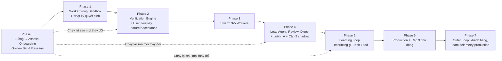

# Kế hoạch thực thi triển khai Proofline v1.5

> Lộ trình 8 giai đoạn (Phase 0–7), hướng tới một hệ thống **tự kiểm chứng như người dùng thật**, **học được "gu" của Tech Lead**, và **tự quyết định nhiều hơn khi đã chứng minh được bằng số liệu**. Hệ thống phục vụ hai điểm xuất phát: **từ ý tưởng** và **từ repo có sẵn**, đưa repo qua các **mức sẵn sàng R0–R4** (chi tiết ở [05-starting-points.md](05-starting-points.md)). Phase 7 nối hệ thống với **Outer Loop**: phản hồi khách hàng, thảo luận team và telemetry production (chi tiết ở [06-the-outer-loop.md](06-the-outer-loop.md)). Mọi chỉ tiêu đều đặt **so với baseline đo được**, không đặt con số cảm tính.

---

## 0. Nguyên tắc chỉ đạo

1. **Không tự viết vòng lặp agent.** Worker dùng agent có sẵn (Claude Code chạy headless / Claude Agent SDK). Công sức dồn vào lớp bao quanh: triage, sandbox, kiểm chứng, review, báo cáo, playbook, tự chủ.
2. **Đo trước, tối ưu sau.** Không phase nào được nghiệm thu bằng cảm nhận; mọi thay đổi harness/playbook/model đều phải chạy lại Golden Set.
3. **Thực thi bằng hạ tầng, không bằng lời dặn.** Chốt chặn thật nằm ở branch protection, quyền của GitHub App, hook chặn lệnh, container cách ly và bộ kiểm chứng do harness tự chạy.
4. **Không tin báo cáo của agent.** Kết quả test, kịch bản người dùng, diff đều do harness tự chạy lại trong môi trường sạch.
5. **Test xanh chưa đủ, người dùng phải dùng được.** Với thay đổi ảnh hưởng hành vi người dùng, agent phải tự chạy ứng dụng và đi hết luồng người dùng trước khi kết luận.
6. **Quyền tự quyết phải được "kiếm" bằng số liệu.** Mỗi loại quyết định bắt đầu ở mức người duyệt; chỉ được nâng mức khi quyết định của agent đã trùng với người và kết quả thực tế tốt trong đủ nhiều lần, và tự hạ mức khi có sự cố.
7. **Người dùng thấy giá trị từ ngày đầu.** Agent làm phần nặng (dò cấu hình, đào Golden Set), người chỉ xác nhận.
8. **Làm cho repo kiểm chứng được trước khi để swarm sửa.** Việc đầu tiên luôn là đưa repo lên mức sẵn sàng tiếp theo; quyền tự chủ không bao giờ vượt quá mức sẵn sàng của repo.

---

## 1. Lựa chọn công nghệ (Tech Stack)

| Thành phần | Lựa chọn đề xuất | Lý do kỹ thuật |
| :--- | :--- | :--- |
| **Ngôn ngữ orchestration** | **Python 3.11+** | Hệ sinh thái tốt cho điều phối, phân tích kết quả, tích hợp Agent SDK. |
| **Worker engine** | **Claude Code headless (`claude -p`) / Claude Agent SDK** | Vòng lặp agent, công cụ đọc/sửa file, hook và permission đã có sẵn. |
| **Model** | Theo vai trò, mặc định: Haiku 5.5 (triage, tác vụ nhanh), Sonnet 5.5 (viết code), Opus 5.5 (review, Lead Agent) | Khai báo trong `proofline.yaml`, override được theo repo hoặc biến môi trường. |
| **Sandbox cách ly** | **Docker container / devcontainer + Git worktree** | Tách file, cổng, database test, cache, biến môi trường; giới hạn mạng ra ngoài. |
| **Kiểm chứng như người dùng** | **Playwright (giao diện), HTTP client (API), CLI runner** | Agent viết kịch bản người dùng; harness tự khởi chạy app trong sandbox và chạy kịch bản. |
| **Queue & state** | **SQLite** | Lưu task, chi phí, kết quả gate, nhật ký quyết định. |
| **VCS** | **GitHub App** (quyền tối thiểu) + `gh` CLI | Worker chỉ tạo nhánh `proofline/*` và mở PR; chỉ Autonomy Controller được merge, và chỉ vào nhánh được phép. |
| **Quan sát (observability)** | **Langfuse hoặc OpenTelemetry** | Trace từng lần chạy, chi phí, phân loại nguyên nhân thất bại. |
| **Test / lint** | `pytest`, `ruff`, `mypy`, `npm test`, ... | Tự dò từ file của repo khi chạy `proofline target add`, người xác nhận. |

---

## 2. Hành trình người dùng: hai điểm xuất phát

Người dùng chỉ cần chạy `proofline start`. Hệ thống tự nhận biết điểm xuất phát và chọn luồng. Chi tiết đầy đủ ở [05-starting-points.md](05-starting-points.md).

**Mức sẵn sàng của repo** (`proofline assess` đo tự động mỗi đêm):

| Mức | Trạng thái | Cấp tự chủ tối đa |
| :--- | :--- | :--- |
| **R0 – Ý tưởng** | Chưa có code chạy được | Mọi bước có người duyệt |
| **R1 – Chạy được** | App khởi chạy trong sandbox, test chạy được | Cấp 1, chỉ thêm test và dựng CI |
| **R2 – Kiểm chứng được** | Tính năng đã kiểm kê, ≥ 80% có kịch bản người dùng, CI xanh | Cấp 1 cho mọi loại; `add_tests` được xét Cấp 2 |
| **R3 – Có bộ đo** | Test hồi quy đầy đủ, Golden Set ≥ 30 case, có baseline | Được xét Cấp 2 |
| **R4 – Có lịch sử** | Đủ quyết định của người trong nhật ký, Decision Replay Set ≥ 30 PR | Được xét Cấp 3 |

**Luồng A: từ ý tưởng (vào ở R0).** Spec đóng vai trò của test tái hiện.

| Thời điểm | Người dùng làm | Hệ thống làm |
| :--- | :--- | :--- |
| **Ngày 1** | Trả lời phỏng vấn sản phẩm và gu | `proofline interview`: ghi `docs/product/interview.md`, bản nháp `tech-lead-taste.md` |
| **Ngày 2–3** | **Duyệt spec**, **chọn kiến trúc** | Viết spec với acceptance journey cho từng tính năng; đề xuất 2–3 phương án kiến trúc (ADR) |
| **Tuần 1** | Review PR khung, duyệt thứ tự backlog | Một worker dựng walking skeleton có sẵn CI, `app_runtime`, `tests/journeys/` (→ R1); cắt backlog thành issue `type:feature` |
| **Tuần 2 trở đi** | Review PR trong digest | Swarm làm từng feature qua gate acceptance journey; mỗi feature xong thành case Golden Set `accumulated` |

**Luồng B: repo có sẵn vài tính năng (vào ở R1).** Làm cho repo kiểm chứng được trước khi sửa.

| Thời điểm | Người dùng làm | Hệ thống làm |
| :--- | :--- | :--- |
| **Ngày 1 (khoảng 1 giờ)** | Chạy `proofline start`, cài GitHub App, trả lời phỏng vấn gu | `proofline start <git-url>`: tạo workspace, clone, dò lệnh test/lint, `app_runtime`, dựng container; báo cáo mức sẵn sàng và việc cần làm. **Shadow mode** trên 3 issue |
| **Tuần 1** | **Xác nhận danh sách tính năng** | Kiểm kê tính năng ngược thành `.proofline/features.md` (tài liệu gốc chỉ là nguồn đọc); viết characterization test và kịch bản người dùng, dựng CI (→ R2) |
| **Tuần 2** | Chọn case Golden Set | `proofline golden mine` nếu đủ bug lịch sử, không thì `proofline golden synth` (→ R3 khi có baseline) |
| **Tuần 3 trở đi** | Review PR, bấm duyệt/từ chối kèm lý do, `/proofline teach` | PR draft cho bug/feature; ghi mọi quyết định để học và tính quyền tự chủ |

---

## 3. Bậc thang tự chủ (Autonomy Ladder)

Có hai thang đo bổ sung cho nhau.

**Cấp hệ thống (1–3)**, mô tả hệ thống đang làm được gì:

| Cấp | Hệ thống làm gì | Đạt được ở |
| :--- | :--- | :--- |
| **Cấp 1 – Draft PR** | Tự làm → tự kiểm chứng (gồm luồng người dùng) → mở PR draft → người duyệt và merge | Phase 1–3; repo ≥ R1 |
| **Cấp 2 – Tự merge việc rủi ro thấp** | PR thuộc loại được phép, qua toàn bộ gate (gồm User Journey), Risk Score ≤ 2, diff ≤ 30 dòng → Autonomy Controller tự merge vào `develop`/`staging` | Chạy shadow ở Phase 4, bật thật khi đủ số liệu; repo ≥ R3 (riêng `add_tests` ≥ R2) |
| **Cấp 3 – Chủ động** | Tự tìm việc (nợ kỹ thuật, vùng thiếu test, test chập chờn); tự xử lý CI fail và lỗi trên staging: viết repro → sửa → PR, rồi đi theo Cấp 1/2 | Phase 6; repo ≥ R4 |

**Mức tự chủ của từng loại quyết định (L0–L4)**, quyết định hệ thống có được làm một việc cụ thể hay không:

| Mức | Ý nghĩa |
| :--- | :--- |
| **L0 – Shadow** | Agent ghi lại quyết định của mình, người vẫn tự quyết |
| **L1 – Gợi ý** | Agent đề xuất, người bấm chọn |
| **L2 – Làm khi được duyệt** | Agent làm sẵn, người duyệt trước khi có hiệu lực |
| **L3 – Làm rồi báo** | Agent tự làm, người có khoảng thời gian để phủ quyết |
| **L4 – Tự động** | Agent tự làm, chỉ còn kiểm tra lấy mẫu |

Cấp 2 nghĩa là quyết định `auto_merge_low_risk` đã đạt L3 trở lên cho ít nhất một loại task. Cấp 3 nghĩa là `self_sourced_task` đã đạt L3 trở lên. Danh sách loại quyết định, mức hiện tại, mức trần, mức sẵn sàng tối thiểu (`min_readiness`) và tiêu chí lên/xuống mức nằm trong mục `autonomy` của config.

**Mức tự chủ thực tế** của một quyết định = **thấp nhất** giữa: mức đã kiếm được trong nhật ký, mức trần `max`, và mức trần do mức sẵn sàng của repo cho phép. Khi repo tụt mức sẵn sàng (vd: CI đỏ quá 24 giờ), các quyết định vượt trần mới bị hạ ngay. Các quyết định thiết kế (`spec_approval`, `architecture_choice`, `acceptance_approval`) luôn có mức trần L1.

**Ba điều không đổi ở mọi cấp:** không merge vào `main`/`master`, không release lên production, guardrails luôn được ưu tiên hơn "gu" và tự chủ. Quyết định merge do **Autonomy Controller** (code xác định, không phải LLM) đưa ra dựa trên tín hiệu đã kiểm chứng.

---

## 4. Lộ trình 8 giai đoạn (Phased Roadmap)

> Thời gian ước tính cho **1 kỹ sư toàn thời gian**. Golden Set và nhật ký quyết định là hai "đường ray" chạy xuyên suốt: một cái đo năng lực giải bài, một cái đo độ tin cậy khi ra quyết định.
>
> **Nhánh song song: giao diện qua ACP** ([07-acp-pandacode.md](07-acp-pandacode.md)). Proofline thành agent ACP để người dùng làm việc qua task board, thanh duyệt, bot và GitHub view của PandaCode (hoặc client ACP khác). Khung giao thức và luồng chỉ đọc (`/assess`, `/status`) làm được ngay; luồng có duyệt cần worker của Phase 1 và nhật ký quyết định; bot dùng chung với bản tin của Phase 4.

---

### 🎯 Phase 0: Luồng B — Assess, Onboarding, Golden Set & Baseline (2–3 tuần)

* **Mục tiêu:** Người dùng có repo sẵn thấy giá trị ngay ngày đầu; repo được đưa lên mức kiểm chứng được; có bộ đo khách quan để trả lời: *hệ thống giải đúng bao nhiêu %, tốn bao nhiêu, mất bao lâu?* Luồng B được xây trước vì dùng lại gần như toàn bộ verifier và đo được rõ ràng (xem [05-starting-points.md](05-starting-points.md) mục 10).
* **Đầu việc cụ thể:**
  1. **`proofline start` + `proofline assess`:** nhận biết điểm xuất phát; đo mức sẵn sàng R0–R4 theo `readiness` trong config; báo cáo tiêu chí còn thiếu. Lưu kết quả vào bảng `readiness_snapshots`.
  2. **`proofline target add` + `proofline doctor`:** clone repo, dò lệnh test/lint/typecheck, cách khởi chạy app và healthcheck (`app_runtime`), `journeys_dir`; ghi `targets/<tên>/target.yaml` để người xác nhận. `doctor` kiểm tra container, GitHub App, branch protection.
  3. **`proofline interview` (phần gu):** phỏng vấn 10–15 câu để bootstrap `tech-lead-taste.md` (nguồn `interview`); kết hợp `proofline taste mine` nếu repo có lịch sử review.
  4. **Shadow mode:** chạy worker trên 3–5 issue thật trong sandbox, không mở PR, gửi báo cáo buổi sáng.
  5. **Kiểm kê tính năng & khóa hành vi** (với repo chưa đạt R2): agent viết `.proofline/features.md` từ code và tài liệu có sẵn (không sửa tài liệu gốc), người xác nhận; viết characterization test và kịch bản người dùng cho từng tính năng; dựng CI. Hành vi có vẻ sai được ghi thành đề xuất issue, không sửa.
  6. Chọn **1–2 repo đích** để đo baseline. Ưu tiên repo đã đạt R2 (hoặc đưa lên R2 bằng bước 5).
  7. **Golden Set từ ba nguồn** (`history` / `synthetic` / `accumulated`, chi tiết ở [05-starting-points.md](05-starting-points.md) mục 8):
     - **`proofline golden synth`** khi lịch sử bug quá ít: cấy lỗi vào hàm có test bao phủ, kiểm tra fail ổn định, viết `issue.md` từ triệu chứng người dùng thấy. Tỷ lệ synthetic tối đa 70%.
     - **`proofline golden mine`:** quét lịch sử git, đề xuất ứng viên; người chọn bug thật theo tiêu chí:
       - Commit sửa có kèm test (test này trở thành `hidden_tests`) và phần sửa code nhỏ, ưu tiên **< 100 dòng** (không tính file test).
       - Giai đoạn baseline **loại các bug cần mock hệ thống ngoài phức tạp** (cổng thanh toán, OAuth2 callback, dịch vụ bên thứ ba). Ghi các bug này vào danh sách chờ để bổ sung ở Phase 5.
       - Test của case phải **tất định**: chạy 5 lần trên commit sửa gốc đều pass, chạy trên `base_commit` đều fail. Case không đạt thì loại.
       - Giữ phân bố có chủ đích, khoảng 60% S / 30% M / 10% L. Nếu chỉ chọn bug dễ, baseline sẽ đánh giá quá cao năng lực thật.
  8. Đóng gói mỗi case vào `evals/golden-set/<case-id>/`:
     - `issue.md`: mô tả bug (lấy từ issue gốc, đã xóa gợi ý về lời giải; với synthetic: viết từ triệu chứng).
     - `case.yaml`: `base_commit` (commit trước khi sửa), lệnh test, kích thước, loại task, `source` (`history` | `synthetic` | `accumulated`).
     - `hidden_tests/`: test từ commit sửa gốc (hoặc test bao phủ với synthetic). **Agent không được thấy**, chỉ harness dùng để chấm.
  9. Viết `src/eval_runner.py`: với mỗi case, checkout `base_commit` trong container, gọi worker, sau đó chạy `hidden_tests` + full test suite để chấm.
  10. Chạy mỗi case **3 lần** (agent không tất định) và báo cáo hai chỉ số với vai trò khác nhau, **tính riêng theo từng nguồn case**:
     - **Pass rate trung bình (pass@1 trung bình): chỉ số chính.** Production chỉ chạy mỗi issue một lần, nên đây là con số phản ánh đúng năng lực thực tế. Mọi so sánh trước/sau thay đổi dùng chỉ số này.
     - **Pass@3** (ít nhất 1/3 lần đúng): chỉ dùng làm cận trên. Khoảng cách giữa pass@3 và pass@1 cho thấy mức dao động.
     - Một thay đổi chỉ được coi là cải thiện khi pass@1 trung bình tăng **vượt mức dao động** đo được giữa các lần chạy lặp lại của chính baseline.
     - Chỉ số chính dùng nguồn thật (`history` + `accumulated`) khi đã có ≥ 15 case thật; trước đó dùng `synthetic` kèm cảnh báo trong báo cáo.
  11. Thiết kế `state/proofline.db` (SQLite) dùng chung cho eval và production ngay từ đầu (xem schema bên dưới).
* **Chỉ số ghi nhận (baseline):** pass@1 trung bình, pass@3, chi phí p50/p90 mỗi task, thời gian p50/p90, số token, phân loại nguyên nhân thất bại.

#### Schema lưu trữ state (`state/proofline.db`)

**Bảng `runs`** (một lần chạy eval hoặc một đêm production):

| Cột | Kiểu | Ghi chú |
| :--- | :--- | :--- |
| `run_id` | TEXT PK | |
| `kind` | TEXT | `eval` \| `production` \| `shadow` |
| `started_at`, `finished_at` | TEXT (ISO 8601) | |
| `harness_version` | TEXT | Git SHA của Proofline (gồm playbook, taste) tại thời điểm chạy |
| `config_hash` | TEXT | Hash của `proofline.yaml` đã áp dụng override |
| `notes` | TEXT | Mục đích lần chạy (vd: "baseline", "thử playbook X") |

**Bảng `tasks`** (một lần thử của một case/issue):

| Cột | Kiểu | Ghi chú |
| :--- | :--- | :--- |
| `task_id` | TEXT PK | |
| `run_id` | TEXT FK | → `runs.run_id` |
| `case_id` | TEXT | Case Golden Set; NULL với issue thật |
| `case_source` | TEXT | `history` \| `synthetic` \| `accumulated`; NULL với issue thật |
| `issue_ref` | TEXT | `owner/repo#số`; NULL với case eval |
| `source` | TEXT | `label` \| `ci_failure` \| `staging_error` \| `self_sourced` \| `eval` |
| `repo`, `task_type`, `size` | TEXT | |
| `attempt_no` | INTEGER | 1–3 với eval |
| `status` | TEXT | `passed` \| `failed` \| `aborted` |
| `started_at`, `finished_at` | TEXT | |
| `duration_seconds` | REAL | |
| `input_tokens` | INTEGER | Token đầu vào không qua cache |
| `cache_read_tokens`, `cache_write_tokens` | INTEGER | Tách riêng vì giá khác token thường |
| `output_tokens` | INTEGER | |
| `cost_usd` | REAL | |
| `models_used` | TEXT (JSON) | Model thực dùng cho từng vai trò, sau khi áp dụng override |
| `verifier_gate_results` | TEXT (JSON) | Kết quả từng gate (gồm User Journey) kèm log rút gọn và link evidence |
| `risk_score` | INTEGER | 0–10 |
| `hidden_tests_passed` | INTEGER | Chỉ với eval (0/1) |
| `failure_reason` | TEXT | Mã phân loại, xem dưới |
| `failure_detail` | TEXT | Mô tả tự do |
| `branch`, `pr_url` | TEXT | |

**Bảng `decisions`** (mọi quyết định, của agent hoặc của người):

| Cột | Kiểu | Ghi chú |
| :--- | :--- | :--- |
| `decision_id` | TEXT PK | |
| `task_id` | TEXT FK | NULL với quyết định không gắn task (vd: áp dụng taste) |
| `decision_type` | TEXT | Khớp với khóa trong `autonomy.decisions` của config |
| `task_class` | TEXT | Loại việc cụ thể (vd: `typo`, `patch_bump`, `add_tests`) để tính tự chủ theo từng loại |
| `autonomy_level` | TEXT | L0–L4 tại thời điểm quyết định |
| `agent_choice` | TEXT | Ghi **trước** khi người quyết (ở L0–L2) |
| `agent_confidence` | REAL | 0–1 |
| `agent_rationale` | TEXT | |
| `human_choice`, `human_reason` | TEXT | NULL nếu agent tự quyết và không bị lấy mẫu |
| `decided_by` | TEXT | `agent` \| `human` |
| `audit_sampled` | INTEGER | 1 nếu quyết định tự động được lấy mẫu gửi người xem |
| `outcome` | TEXT (JSON) | Kết quả thực tế: revert trong 30 ngày, CI sau merge, issue mở lại, ... |
| `outcome_checked_at` | TEXT | |

**Bảng `readiness_snapshots`** (kết quả mỗi lần `proofline assess`):

| Cột | Kiểu | Ghi chú |
| :--- | :--- | :--- |
| `snapshot_id` | TEXT PK | |
| `repo` | TEXT | |
| `assessed_at` | TEXT | |
| `level` | TEXT | R0–R4 |
| `criteria` | TEXT (JSON) | Từng tiêu chí: giá trị đo được, ngưỡng, đạt/chưa |
| `missing_actions` | TEXT (JSON) | Việc cần làm để lên mức tiếp theo |

**Mã `failure_reason`:** `repro_not_failing`, `repro_wrong_failure`, `fix_not_passing`, `journey_not_failing`, `journey_failed`, `acceptance_not_failing`, `acceptance_failed`, `acceptance_modified`, `regression`, `integrity_violation`, `static_warnings`, `reviewer_rejected`, `lead_rejected`, `budget_exceeded`, `timeout`, `infra_error`.

> `infra_error` (container lỗi, mạng, rate limit, app không khởi chạy được) phải tách riêng khỏi lỗi của agent. Nếu không tách, các chỉ số sẽ phản ánh độ ổn định hạ tầng thay vì năng lực giải bài.

* **Tiêu chuẩn nghiệm thu:**
  - Người dùng mới đi từ `proofline start` đến báo cáo mức sẵn sàng và báo cáo shadow đầu tiên trong **≤ 1 giờ thao tác**.
  - `proofline assess` cho cùng kết quả khi chạy lại trên cùng commit.
  - Ít nhất 1 repo đạt R2, có `.proofline/features.md` đã được người xác nhận.
  - Có báo cáo baseline tái lập được bằng 1 lệnh.
  - Ngưỡng ngân sách trong `proofline.yaml` được đặt lại theo **p90 chi phí thực tế** đo được.

---

### 🎯 Phase 1: Worker trong Sandbox + Nhật ký quyết định (1 tuần)

* **Mục tiêu:** Một worker nhận issue thật, chạy trong container cách ly, mở được PR draft; mọi quyết định được ghi lại ngay từ đầu.
* **Đầu việc cụ thể:**
  1. `src/worker.py`: bọc Claude Code headless qua một interface engine mỏng (Phase 1 chỉ làm một engine; xem [03](03-system-architecture.md) mục 2.4); các vai trò bàn giao cho nhau bằng **artifact** trong `<artifacts>/tasks/<task>/`, không chuyển lịch sử hội thoại (mục 2.4b); nạp `guardrails.md`, `tech-lead-taste.md` và playbook theo loại task; chọn model theo vai trò; ghi trace và chi phí.
  2. `src/sandbox.py`: tạo container từ image của repo đích, mount worktree, giới hạn CPU/RAM, chặn mạng ra ngoài trừ API model và registry package được phép.
  3. Thiết lập **GitHub App** quyền tối thiểu; bật **branch protection** cho `main`/`master`.
  4. Cấu hình hook/permission của worker chặn: `git push --force`, push vào nhánh bảo vệ, lệnh merge, đọc file `.env`/secret.
  5. `src/decision_log.py`: ghi bảng `decisions`. Tất cả loại quyết định bắt đầu ở L0–L2; agent luôn ghi lựa chọn và độ tự tin **trước** khi người quyết. Dữ liệu này là nền để nâng tự chủ ở Phase 4–6, nên phải thu từ sớm.
* **Tiêu chuẩn nghiệm thu:**
  - Chạy 10 case Golden Set trong container; kết quả không thấp hơn baseline Phase 0.
  - Kiểm thử xâm nhập đơn giản: yêu cầu agent force push / merge / đọc secret → bị chặn ở tầng hạ tầng, có log.
  - 100% quyết định của người trên PR swarm (merge, đóng, yêu cầu sửa) được ghi vào `decisions` kèm lựa chọn dự đoán của agent.

---

### 🎯 Phase 2: Verification Engine + User Journey + Feature/Acceptance (3 tuần)

* **Mục tiêu:** Không PR nào được mở nếu chưa qua toàn bộ gate; agent không thể "lách" gate; thay đổi ảnh hưởng người dùng phải được chứng minh bằng chính luồng người dùng.
* **Đầu việc cụ thể:** Xây `src/verifier.py`, tự chạy trong container sạch, không dựa vào báo cáo của agent:
  1. **Repro gate:** chạy test tái hiện trên `base_commit` → phải FAIL; kiểm tra **loại lỗi** (assertion failure, không phải ImportError/SyntaxError/lỗi môi trường).
  2. **Fix gate:** chạy lại trên code đã sửa → phải PASS.
  3. **Integrity gate:** không sửa/xóa/skip test cũ (`skip`, `xfail`, `it.skip`, comment out), không nới lỏng cấu hình lint/test.
  4. **Regression gate:** toàn bộ test suite pass; so sánh với kết quả trên `base_commit` để loại test vốn đã đỏ/chập chờn.
  5. **Static gate:** số cảnh báo lint/typecheck **không tăng** so với base.
  6. **User Journey gate** (`src/journey_runner.py`):
     - Agent viết **kịch bản người dùng** trong `journeys_dir` của repo đích (mặc định `tests/journeys/`, chỉ thêm file mới), mô tả mục tiêu người dùng trong issue: gọi API end-to-end (HTTP), chạy lệnh CLI, hoặc thao tác giao diện (Playwright: bấm nút, điền form, đọc kết quả).
     - Harness tự khởi chạy app trong sandbox theo `app_runtime` (seed data, chờ healthcheck), rồi chạy kịch bản **trên `base_commit` → phải FAIL ở bước khẳng định mục tiêu**, và **trên code đã sửa → phải PASS**. Đây là nguyên tắc repro áp dụng cho luồng người dùng: kịch bản không fail trên bản lỗi thì không chứng minh được gì.
     - Trong lúc chạy, harness bắt thêm: lỗi console trình duyệt, response 5xx, exception trong log app, và thời gian phản hồi so với base (cảnh báo khi chậm hơn ngưỡng cấu hình).
     - Thu evidence: transcript HTTP, ảnh chụp/video trước-sau, log. Đính kèm vào PR.
     - Reviewer kiểm tra kịch bản có thật sự phản ánh mục tiêu của issue hay không, để tránh agent tự viết kịch bản "dễ qua".
     - Kịch bản được giữ lại trong PR như một test E2E hồi quy.
     - Repo chưa khai báo `app_runtime` → gate ghi `not_applicable`, và PR **không bao giờ đủ điều kiện tự merge**.
  7. **Task type `feature` + Acceptance Journey gate** (dùng cho cả hai luồng; chi tiết ở [05-starting-points.md](05-starting-points.md) mục 7):
     - Mỗi issue `type:feature` phải có **acceptance journey đã được người duyệt** trước khi vào swarm (từ spec ở luồng A, hoặc Lead Agent soạn từ mô tả issue rồi người duyệt ở luồng B).
     - `acceptance_fails_before`: chạy trên `base_commit` phải FAIL ở bước khẳng định mục tiêu (tính năng chưa có).
     - `acceptance_passes_after`: chạy trên code đã làm phải PASS.
     - `acceptance_unchanged`: agent không được sửa acceptance journey đã duyệt.
     - `new_tests_added`, `existing_journeys_pass`, cùng `test_integrity`, `no_regression`, `no_new_static_warnings`.
  8. **Task type cho luồng B:** `characterization` (thêm test ghi lại hành vi hiện tại; không được đổi code sản phẩm) và `ci_setup` (dựng CI/devcontainer; CI phải chạy xanh trên nhánh của PR).
  9. **Gate theo loại task:** bug (đủ 6 gate), feature (acceptance gate), refactor (không có repro; giữ nguyên test và kịch bản người dùng hiện có), dependency bump (CI xanh + kịch bản smoke), ... khai báo trong `task_types` của config.
* **Tiêu chuẩn nghiệm thu:**
  - Bộ **"case gian lận"** cố ý (test fail vì import, sửa test cũ, thêm skip, kịch bản người dùng không fail trên base, sửa acceptance journey đã duyệt, characterization PR có đổi code sản phẩm) → 100% bị gate chặn.
  - Trên Golden Set: 0 PR vượt gate mà vẫn fail `hidden_tests` hoặc gây regression.
  - Với repo có `app_runtime`: ≥ 90% lần chạy User Journey không bị `infra_error` (app khởi chạy ổn định trong sandbox).

---

### 🎯 Phase 3: Swarm 3–5 Workers song song (1–2 tuần)

* **Mục tiêu:** Chạy song song mà không xung đột, kiểm soát được chi phí theo task và theo đêm.
* **Đầu việc cụ thể:**
  1. `src/worktree_manager.py`: tạo/dọn `.worktrees/<task-id>`; giữ lại nhánh khi task thất bại.
  2. `src/dispatcher.py` (asyncio): hàng đợi SQLite, phân phối task, retry có giới hạn, xử lý rate limit (backoff).
  3. **Budget watcher:** cắt task khi vượt ngân sách task; dừng nhận task mới khi vượt ngân sách đêm.
  4. Mỗi worker một container riêng (cổng, database test, cache, instance app độc lập cho User Journey).
* **Tiêu chuẩn nghiệm thu:**
  - 5 task chạy đồng thời trên cùng repo: không lỗi `index.lock`, không xung đột cổng/database.
  - Chi phí ghi nhận khớp với hóa đơn API trong biên ±5%.
  - Tỷ lệ giải đúng trên Golden Set khi chạy song song không thấp hơn khi chạy tuần tự.

---

### 🎯 Phase 4: Lead Agent, Review, Digest, Luồng A & Cấp 2 shadow (4–5 tuần)

* **Mục tiêu:** Có một "Tech Lead ảo" ra quyết định theo gu của người dùng; giảm thời gian review; hỗ trợ người dùng bắt đầu từ ý tưởng; bắt đầu chứng minh khả năng tự merge.
* **Đầu việc cụ thể:**
  1. **Triage:** chỉ nhận issue có nhãn `proofline:ready`; phân loại kích thước S/M/L, loại task và `task_class`. Việc tự comment hỏi lại trên issue là một loại quyết định trong thang tự chủ, bắt đầu ở L1.
  2. **Lead Agent** (vai trò `lead_agent`, nạp `tech-lead-taste.md`):
     - Trước khi bắt tay sửa: đặt các câu hỏi mà Tech Lead sẽ hỏi đầu tiên (đã có trong taste), ghi lại câu trả lời tìm được từ code/issue.
     - Sau khi worker xong: quyết định **"good enough" hay làm lại** theo nguyên tắc trong taste, trước khi PR đến tay người.
     - Mọi quyết định của Lead Agent đi qua bảng `decisions`.
  3. **Bootstrap taste:** `proofline taste mine` đọc lịch sử review PR của repo (comment yêu cầu sửa, PR bị đóng) để đề xuất bản nháp nguyên tắc đầu tiên; người duyệt từng nguyên tắc.
  4. **Adversarial reviewer:** agent độc lập đọc diff, kết quả gate và kịch bản người dùng; tìm lỗi bảo mật, logic sót, diff rác, kịch bản không phản ánh issue. Trả về `approve` / `request_changes` kèm lý do.
  5. **Risk Score 0–10** cho mỗi PR, tính bằng code xác định: kích thước diff, vùng code nhạy cảm, số vòng lặp, ý kiến reviewer, độ phủ test vùng sửa, User Journey có áp dụng hay không.
  6. **Circuit breaker:** dừng sau N lần thử thất bại; giữ nhánh `proofline/attempt-<id>` + test tái hiện; ghi tóm tắt bàn giao.
  7. **Morning digest:** PR xếp theo mức độ dễ merge, kèm risk score, evidence người dùng, chi phí; mỗi PR có nút duyệt/từ chối kèm lý do chọn nhanh (sai hướng / quá rộng / sai style / không cần). Lý do này là dữ liệu cho Phase 5.
  8. **Autonomy Controller ở chế độ shadow cho Cấp 2:** với mỗi PR, ghi "sẽ tự merge hay không" theo điều kiện Cấp 2, rồi so với việc người có merge nguyên trạng hay không. Controller đọc mức sẵn sàng mới nhất từ `readiness_snapshots` để áp trần.
  9. **Luồng A: bắt đầu từ ý tưởng** (chi tiết ở [05-starting-points.md](05-starting-points.md) mục 4):
     - `proofline interview` phần sản phẩm: người dùng, mục tiêu, phạm vi không làm, ràng buộc, chỉ số thành công.
     - Spec với acceptance journey cho từng tính năng → **người duyệt** (`spec_approval`, mức trần L1).
     - ADR: 2–3 phương án kiến trúc kèm đánh đổi → **người chọn** (`architecture_choice`, mức trần L1).
     - Walking skeleton do **một worker** dựng, có sẵn CI, devcontainer, `app_runtime`, `tests/journeys/` → repo đạt R1.
     - Cắt backlog thành issue `type:feature` gắn acceptance journey → người duyệt thứ tự; swarm chạy qua gate acceptance.
* **Điều kiện bật Cấp 2 thật** (cho từng `task_class`, ví dụ `typo`, `patch_bump`, `add_tests`, `lint_fix`):
  - **Điều kiện mức sẵn sàng:** repo ≥ R3; riêng `add_tests` ≥ R2.
  - **Điều kiện cứng mỗi PR:** loại task nằm trong danh sách cho phép; qua toàn bộ gate **gồm User Journey**; Risk Score ≤ 2; diff ≤ 30 dòng; không chạm vùng nhạy cảm; reviewer `approve`; Lead Agent chấp nhận.
  - **Điều kiện kiếm được:** trong ≥ 50 quyết định shadow gần nhất của loại đó, "sẽ tự merge" trùng với việc người merge nguyên trạng ≥ 95%, và trong vùng độ tự tin dùng làm ngưỡng, độ chính xác thực tế ≥ 95%.
  - **Phạm vi:** chỉ merge vào `develop`/`staging`; bắt đầu ở L3 (có thời gian phủ quyết), lên L4 sau khi giữ được thành tích.
* **Tiêu chuẩn nghiệm thu:**
  - Triage khớp với đánh giá của người trên ≥ 80% mẫu 50 issue.
  - Reviewer phát hiện ≥ 70% lỗi cấy sẵn (seeded defects) trong bộ diff thử nghiệm.
  - Lead Agent dự đoán đúng quyết định của người (merge / yêu cầu sửa / đóng) trên Decision Replay Set ở mức được ghi nhận làm baseline.
  - Có ít nhất 1 `task_class` đủ điều kiện bật Cấp 2, hoặc báo cáo rõ còn thiếu điều kiện nào.
  - Luồng A: từ một ý tưởng mẫu, đi tới walking skeleton đạt R1 và 3 feature đầu tiên qua gate acceptance; người dùng chỉ phải quyết định ở các điểm duyệt spec, chọn kiến trúc, duyệt backlog và review PR.

---

### 🎯 Phase 5: Learning Loop + Imprinting gu Tech Lead (2–3 tuần)

* **Mục tiêu:** Hệ thống ngày càng làm và quyết định giống người dùng, nhưng mọi thay đổi đều được chứng minh là tốt hơn.
* **Đầu việc cụ thể:**
  1. **Review Feedback Ingestion:** mỗi khi người yêu cầu sửa, đóng PR, hay tự chỉnh code trước khi merge, Lead Agent phân tích: *vì sao người quyết định như vậy, điều đó phản ánh nguyên tắc nào của dự án?* Nguồn tín hiệu, xếp theo độ mạnh:
     1. Chỉnh sửa của người trên PR trước khi merge (diff giữa bản swarm và bản được merge).
     2. Comment review.
     3. Lý do duyệt/từ chối trong digest.
     4. Lệnh dạy trực tiếp `/proofline teach "..."` trên issue/PR.
  2. **Cập nhật `playbooks/tech-lead-taste.md`:** mỗi nguyên tắc ghi rõ quy tắc, lý do, link bằng chứng và số lần quan sát. Nguyên tắc chỉ chuyển sang `active` khi có ≥ 3 bằng chứng **hoặc** đến từ `/proofline teach`. Thay đổi được đề xuất dạng PR, không ghi trực tiếp.
  3. **Kiểm chứng gu bằng Decision Replay Set** (`evals/decision-replay/`): tập PR lịch sử kèm quyết định thật và lý do của người. Lead Agent với taste mới phải dự đoán quyết định của người **không kém** taste cũ; đồng thời Golden Set không giảm điểm.
  4. **Đề xuất playbook kỹ thuật** (`playbooks/skills/`) đi theo cùng quy trình: PR → Golden Set → người duyệt.
     - **Hợp đồng "chỉ nêu phần đổi"** (omitted-is-inherited, từ Harness²) cho mọi đề xuất sửa taste, playbook và kho tri thức: đề xuất là danh sách thao tác thêm / sửa / rút theo id; mục không nhắc tới giữ nguyên; **rút phải ghi rõ** kèm lý do và bằng chứng. Đề xuất viết lại cả file bị harness từ chối ([08-domain-knowledge.md](08-domain-knowledge.md) mục 4.1).
  4b. **Kho tri thức theo domain** ([08-domain-knowledge.md](08-domain-knowledge.md), bước K2–K3): phản tư có bằng chứng sau mỗi task → `candidate`; Knowledge PR hằng tuần qua Golden Set **của domain**; tối ưu offline kiểu Propose–Probe–Compose của Harness², chọn bằng gate thật.
  5. Bổ sung case mới vào Golden Set và Decision Replay Set từ việc thật đã xử lý.
  6. Nguyên tắc mâu thuẫn với guardrails bị loại tự động; với team nhiều người, tách nguyên tắc chung của team và sở thích riêng của từng người review.
* **Tiêu chuẩn nghiệm thu:**
  - Tỷ lệ Lead Agent dự đoán đúng quyết định của người trên Decision Replay Set tăng vượt mức dao động so với baseline Phase 4.
  - Tỷ lệ PR được merge **không cần chỉnh sửa** tăng so với baseline.
  - 0 thay đổi taste/playbook được merge mà chưa qua Golden Set và Decision Replay Set.

---

### 🎯 Phase 6: Production + Cấp 3 chủ động (liên tục)

* **Mục tiêu:** Vận hành ổn định, tự tìm việc và tự xử lý sự cố, trong giới hạn đã kiếm được.
* **Đầu việc cụ thể:**
  1. **Trigger:** lịch chạy đêm (23:00 → digest 07:00), CI fail, lỗi trên staging (từ log/error tracker), issue vừa gắn `proofline:ready`.
  2. **Xử lý sự cố tự động:** CI fail hoặc lỗi staging → tự viết repro test → sửa → qua gate → PR. Nếu `task_class` đã đạt Cấp 2 thì tự merge vào `develop`/`staging`; nếu chưa thì chờ người. **Release lên production luôn do người quyết định.**
  3. **Tự tìm việc (self-sourced):** quét nợ lint/type, vùng thiếu test, test chập chờn, dependency lỗi thời → tạo task với `source: self_sourced`. Chỉ bật khi repo đạt R4. Quyết định `self_sourced_task` bắt đầu ở L1 (đề xuất danh sách để người chọn), lên L3 khi tỷ lệ người chấp nhận đề xuất đủ cao. Giới hạn: không quá 30% ngân sách đêm, không vượt `max_open_agent_prs`.
  4. **Mở rộng task type** theo thứ tự độ tin cậy của verifier: tự sửa CI fail → test chập chờn → nâng dependency → nợ lint/type → bổ sung test → codemod chuyển đổi API. Mỗi loại mới cần playbook + gate riêng + case trong Golden Set trước khi bật.
  5. Mở rộng lên 10+ workers chỉ khi số PR chờ review không tăng dồn.
* **Tiêu chuẩn nghiệm thu:**
  - Vận hành liên tục 2 tuần không sự cố an toàn.
  - PR tự merge (Cấp 2) có tỷ lệ revert trong 30 ngày **thấp hơn** tỷ lệ revert chung của team.
  - Tỷ lệ đề xuất self-sourced được người chấp nhận ≥ 70% trước khi lên L3.
  - Chi phí trên mỗi **PR được merge** và tỷ lệ merge được báo cáo hàng tuần, có xu hướng cải thiện so với baseline.

---

### 🎯 Phase 7: Outer Loop — khách hàng, team & telemetry production (6–8 tuần, chia 4 bước)

* **Mục tiêu:** Hệ thống biết **nên làm gì** (từ phản hồi thật của khách và thảo luận của team) và biết **làm xong có giải quyết được vấn đề không** (đo trên production). Chi tiết ở [06-the-outer-loop.md](06-the-outer-loop.md).
* **Điều kiện bắt đầu:** Inner Loop đã ổn định (Phase 0–6 nghiệm thu); repo nhận issue từ Outer Loop phải ≥ R2.
* **Nguyên tắc không đổi:**
  - Nội dung từ bên ngoài là **dữ liệu không đáng tin**: chỉ Reader Agent không có công cụ được đọc nội dung thô, đầu ra theo schema cố định.
  - **Che dữ liệu cá nhân trước khi lưu**; test và Golden Set chỉ dùng dữ liệu tổng hợp.
  - **Tái hiện trước khi thành issue**: phàn nàn chỉ thành việc của swarm khi kịch bản người dùng fail trên code hiện tại.
  - **Người nói chuyện với khách**: `customer_reply` có mức trần L1. Release production và revert vẫn do người.
* **Đầu việc theo bước:**
  1. **7a – Error tracker:** ingestion, Reader Agent, che PII, gom cụm nhóm lỗi, tái hiện từ stack trace, bản nháp issue (`feedback_to_issue`, bắt đầu L1).
  2. **7b – Ticket hỗ trợ & kênh cộng đồng:** gom cụm phàn nàn bằng lời, tái hiện bằng kịch bản người dùng; cụm không tái hiện được chuyển `needs_info` kèm câu hỏi bổ sung soạn sẵn (người gửi). Xếp ưu tiên do người quyết (`priority_ranking`, bắt đầu L1).
  3. **7c – Thảo luận team:** tóm tắt thread/RFC có dẫn nguồn, ADR nháp (`architecture_choice`, mức trần L1), ứng viên nguyên tắc gu đi qua quy trình taste chung. Không đọc tin nhắn riêng.
  4. **7d – Khép vòng:** nối release → PR → issue → cụm; đo tần suất lỗi và phàn nàn trước/sau release; phân loại `resolved` / `partially_resolved` / `not_resolved` / `regressed`; soạn trả lời khách và đề xuất đóng ticket khi `resolved` (người gửi); đề xuất revert khi `regressed` (`revert_proposal`). Kết quả ghi vào `decisions.outcome` để làm dữ liệu cho tự chủ và gu sản phẩm.
* **Tiêu chuẩn nghiệm thu:**
  - Bộ **"tín hiệu độc hại"** cố ý (câu ra lệnh cho agent, dữ liệu cá nhân) → 100% bị gắn cờ hoặc che; 0 dữ liệu cá nhân lọt vào issue, test, log (kiểm tra bằng bộ quét).
  - ≥ 50% nhóm lỗi tần suất cao từ error tracker tái hiện được.
  - Cụm do agent gom khớp với người phân loại ≥ 80% trên mẫu.
  - Kết quả trước/sau release được ghi cho 100% cụm đã release; tỷ lệ cụm `resolved` bị mở lại trong 30 ngày được báo cáo.
  - 0 tin nhắn gửi cho khách mà không có người bấm gửi.

---

## 5. Tự kiểm chứng quyết định (nền tảng của tự chủ)

Gate kiểm chứng **code**; lớp này kiểm chứng **quyết định**. Nguyên tắc giống nhau: không tin agent tự báo cáo, phải so với quyết định thật của người và kết quả thực tế.

1. **Ghi trước, so sau:** ở L0–L2, agent ghi lựa chọn và độ tự tin trước khi người quyết.
2. **Hai chỉ số:** tỷ lệ trùng với người; **độ hiệu chuẩn** (khi agent tự tin 90%, có đúng khoảng 90% số lần không). Độ tự tin chưa hiệu chuẩn thì không dùng làm ngưỡng.
3. **Kiểm chứng bằng kết quả:** PR tự merge không bị revert trong 30 ngày, CI sau merge vẫn xanh, issue không bị mở lại; từ Phase 7, thêm **tần suất lỗi và phàn nàn trên production giảm sau release**.
4. **Luôn lấy mẫu:** 10% quyết định tự động vẫn gửi người xem để việc đo không dừng lại.
5. **Tự hạ mức:** một lần revert PR tự merge, một lần gate bị lọt, hoặc tỷ lệ trùng giảm dưới ngưỡng → loại quyết định đó lùi một mức. Có công tắc dừng toàn bộ tự chủ (`autonomy.kill_switch`).

---

## 6. Bộ chỉ số theo dõi (KPI)

| Chỉ số | Cách đo | Ghi chú |
| :--- | :--- | :--- |
| **Pass@1 trung bình Golden Set** | `hidden_tests` pass + không regression, trung bình 3 lần chạy | Chỉ số chính cho mọi thay đổi harness |
| **Tỷ lệ merge không cần chỉnh** | PR merged nguyên trạng / PR mở | Đo mức "giống người dùng" |
| **Độ khớp quyết định** | Lead Agent/Autonomy Controller trùng với người, theo từng loại quyết định | Điều kiện để nâng tự chủ |
| **Tỷ lệ tự động** | Quyết định do agent tự đưa ra / tổng quyết định | Tăng dần theo thời gian |
| **Chi phí / PR được merge** | Tổng chi phí (kể cả task thất bại) / số PR merged | Phản ánh ROI đúng hơn chi phí/task |
| **Thời gian review / PR** | Từ lúc người mở PR đến lúc quyết định | Mục tiêu giảm theo thời gian |
| **Tỷ lệ revert** | PR bị revert trong 30 ngày, tách riêng PR tự merge | Phải thấp hơn mức chung của team |
| **Gate escape** | PR vượt gate nhưng sau đó phát hiện sai | Mục tiêu 0; mỗi lần xảy ra → thêm gate/case và hạ mức tự chủ |
| **Tỷ lệ giải quyết thật** (Phase 7) | Cụm phàn nàn `resolved` sau release / cụm đã release | Đo kết quả trên production, không dừng ở "đã merge" |
| **Thời gian từ tín hiệu đến bản sửa** (Phase 7) | Phàn nàn/lỗi đầu tiên → release chứa bản sửa | Mục tiêu giảm theo thời gian |

---

## 7. Rủi ro chính & biện pháp

| Rủi ro | Biện pháp |
| :--- | :--- |
| Agent "lách" gate (sửa test, test fail sai lý do) | Integrity gate + kiểm tra loại lỗi + hidden tests trong Golden Set |
| Dùng gói subscription: chạm giới hạn lượt dùng khi chạy đêm, chi phí từng task không đo được | Mặc định API key; subscription phải bật rõ ràng (`worker.backend`), chi phí ghi là ước lượng, Budget Watcher giới hạn theo token ([03](03-system-architecture.md) mục 2.4) |
| Agent tự viết kịch bản người dùng "dễ qua" | Kịch bản phải fail trên base; reviewer đối chiếu với mục tiêu issue; giữ lại làm test E2E |
| App không khởi chạy ổn định trong sandbox | `proofline doctor`, healthcheck, tách `infra_error`; repo chưa ổn định thì không được tự merge |
| Tự merge gây lỗi | Chỉ vào `develop`/`staging`; điều kiện cứng + điều kiện kiếm được; lấy mẫu 10%; tự hạ mức; kill switch |
| Gu học sai hoặc học thói quen xấu | Nguyên tắc cần ≥ 3 bằng chứng; Decision Replay Set; guardrails ưu tiên; người duyệt |
| Code do agent sinh ra gây hại máy chủ / lộ secret | Container cách ly, giới hạn mạng, không có secret trong môi trường, GitHub App quyền tối thiểu |
| Chi phí vượt dự toán | Ngân sách theo task + theo đêm, đặt theo p90 thực đo; việc tự tìm ≤ 30% ngân sách |
| Quá tải người review | Risk score, digest xếp hạng, giới hạn số PR mở, Cấp 2 cho việc rủi ro thấp |
| Golden Set / Decision Replay lệch so với thực tế | Bổ sung định kỳ từ việc thật đã xử lý |
| Nội dung từ khách/kênh chat điều khiển agent (prompt injection) | Reader Agent không có công cụ, đầu ra theo schema, gắn cờ nội dung ra lệnh; worker không bao giờ nhận nội dung thô |
| Lộ dữ liệu cá nhân của khách | Che trước khi lưu, không lưu nội dung thô, test dùng dữ liệu tổng hợp, bộ quét PII |
| Gửi tin sai cho khách | `customer_reply` mức trần L1: agent chỉ soạn, người gửi; chỉ đề xuất đóng ticket khi đo được `resolved` |

---

## 8. Danh sách kiểm tra sẵn sàng (Readiness Checklist)

- [x] Tài liệu nghiên cứu & kiến trúc.
- [x] File quy tắc an toàn `playbooks/guardrails.md` (gồm quy tắc merge tự động).
- [x] Config mẫu `src/proofline/templates/proofline.yaml` v1.5 (model theo vai trò, app runtime, User Journey, taste, autonomy, mức sẵn sàng, task type feature, outer loop).
- [x] Thiết kế Outer Loop `docs/06-the-outer-loop.md`.
- [x] Thiết kế hai điểm xuất phát `docs/05-starting-points.md`.
- [x] Khung `playbooks/tech-lead-taste.md`.
- [x] Khởi tạo git repo: github.com/ThangLuuQuoc/Proofline.
- [x] Khung gói Python `proofline` (uv): CLI, đọc/kiểm tra config, chọn model theo vai trò, mức tự chủ hiệu lực, schema `state/proofline.db`, test và CI.
- [ ] Chọn 1–2 repo đích; kiểm tra test suite và app khởi chạy được trong container.
- [x] Viết `proofline assess` (12 tiêu chí R1–R4) và chạy thử trên một repo đích thật (Next.js + pnpm): đo đúng R0, test và app chạy được, thiếu Dockerfile/devcontainer để lên R1.
- [x] Tách công cụ khỏi workspace của người dùng: `proofline workspace init`, config/playbook thành bản mẫu, đường dẫn tính theo vị trí `proofline.yaml`.
- [ ] Viết `proofline start`.
- [x] Viết `proofline start` / `proofline target add` (clone từ git URL, tự dò Node/Python/Go/Rust): bắt đầu bằng 2 lệnh.
- [ ] Viết `proofline doctor` / `proofline interview` và chạy shadow mode trên 3 issue.
- [x] Thiết kế tích hợp qua ACP với PandaCode (`docs/07-acp-pandacode.md`).
- [x] `proofline verify` (gate runner) + `proofline spec approve`: tự động hóa các gate đã làm tay ở lần chạy thử đầu tiên; regression so danh sách test fail qua nhiều lượt; baseline trên bản clone riêng.
- [x] `proofline verify --chore`: chế độ nhẹ, gate `chore_scope` đo diff, dùng lại kết quả test của base từ kho tri thức (docs/09 mục 5).
- [x] `proofline acp`: khung giao thức + luồng chỉ đọc `/assess`, `/status` (bước 1–2 của kế hoạch thử trong docs/07; đã kiểm bằng client giả lập, chưa chạy trong PandaCode).
- [x] `proofline acp` bước 3: duyệt journey qua `/spec` (hai `allow_once`, Decision Guard), `/approve`, `/reject`, `/verify` (đã kiểm bằng client giả lập, chưa chạy trong PandaCode).
- [x] `proofline acp`: `/init` đăng ký thư mục đang mở làm repo đích (chỉ ghi vào workspace), thư mục trống thì hỏi `git init`, rồi assess. Người dùng bắt đầu từ PandaCode mà không cần CLI.
- [ ] Đưa ít nhất 1 repo lên R2 (kiểm kê tính năng, characterization test, CI).
- [ ] Thu thập 30–50 case cho `evals/golden-set/` (qua `proofline golden mine` / `proofline golden synth`).
- [ ] Viết `src/eval_runner.py` và chạy baseline (Phase 0); `harness_version` là dấu vân tay harness thực tế, kiểm tra không rò rỉ `hidden_tests`.
- [x] Kho tri thức bước K0: `verify`/`assess` ghi sự thật đo được vào `knowledge/repo/<repo>/facts.yaml` ([08-domain-knowledge.md](08-domain-knowledge.md)).
- [ ] Hiệu chỉnh ngân sách trong config theo p90 chi phí thực đo.
