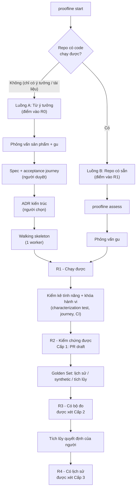

# Hai điểm xuất phát & Mức sẵn sàng của repo

> Người dùng đến với Proofline từ một trong hai điểm: **một ý tưởng chưa có code**, hoặc **một repo đã có vài tính năng nhưng chưa nhiều test**. Cả hai đều thiếu thứ mà swarm cần để tự kiểm chứng (test, CI, lịch sử bug, lịch sử review). Tài liệu này mô tả cách hệ thống **đưa repo lên dần các mức sẵn sàng** trước, rồi mới cho swarm sửa và tự quyết nhiều hơn.
>
> Liên quan: [03-system-architecture.md](03-system-architecture.md) · [04-execution-plan.md](04-execution-plan.md) · [proofline.yaml](../src/proofline/templates/proofline.yaml)

---

## 1. Tổng quan



Hai luồng chỉ khác nhau ở **điểm vào**. Từ R1 trở đi, cả hai đi chung một con đường. Luồng A thực chất là phần "spec + kiến trúc + khung" đặt phía trước luồng B.

---

## 2. Mức sẵn sàng của repo (R0–R4)

`proofline assess` đo các tiêu chí dưới đây **tự động**, chạy lại mỗi đêm và báo mức hiện tại trong digest. Ngưỡng khai báo trong `readiness` của config.

| Mức | Tiêu chí đạt (đo tự động) | Swarm được làm | Cấp tự chủ tối đa |
| :--- | :--- | :--- | :--- |
| **R0 – Ý tưởng** | Chưa có code chạy được | Phỏng vấn, viết spec, đề xuất kiến trúc, dựng khung; **mọi bước có người duyệt** | Không mở PR code ngoài walking skeleton |
| **R1 – Chạy được** | Container build được; app khởi chạy và qua healthcheck trong sandbox; lệnh test chạy được (dù ít test) | Kiểm kê tính năng; viết characterization test, kịch bản người dùng; dựng CI, devcontainer | Cấp 1, chỉ cho task type `characterization` và `ci_setup` |
| **R2 – Kiểm chứng được** | Danh sách tính năng đã được người xác nhận; ≥ 80% tính năng có kịch bản người dùng; CI xanh trên nhánh mặc định | Làm `bug` và `feature` qua đủ gate | Cấp 1 cho mọi loại; riêng `add_tests` được xét Cấp 2 |
| **R3 – Có bộ đo** | Mỗi tính năng có test hồi quy; Golden Set ≥ 30 case; đã đo baseline pass@1 | Như R2 | Được xét Cấp 2 cho các `task_class` cho phép |
| **R4 – Có lịch sử** | Decision Replay Set ≥ 30 PR; mỗi loại quyết định cần xét có ≥ 50 quyết định của người trong nhật ký | Như R3, thêm tự tìm việc | Được xét Cấp 3 |

**Mức sẵn sàng có thể giảm.** Ví dụ: CI đỏ trên nhánh mặc định quá 24 giờ, hoặc app không còn khởi chạy được trong sandbox → repo tụt mức. Khi đó mọi quyết định vượt quá mức mới bị hạ ngay về mức trần tương ứng.

> "Được xét" nghĩa là đủ điều kiện **để bắt đầu kiếm** quyền tự chủ. Quyền đó vẫn phải được chứng minh bằng nhật ký quyết định như trong [04-execution-plan.md](04-execution-plan.md) mục 3 và 5.

---

## 3. Các lệnh

| Lệnh | Việc làm | Dùng ở |
| :--- | :--- | :--- |
| `proofline start` | Một cửa vào: tự nhận biết repo trống / chỉ có tài liệu ý tưởng hay đã có code, rồi đi vào luồng A hoặc B | Lần đầu |
| `proofline assess` | Đo mức sẵn sàng R0–R4, liệt kê tiêu chí còn thiếu và việc cần làm để lên mức tiếp theo | Lần đầu, sau đó mỗi đêm |
| `proofline interview` | Phỏng vấn sản phẩm (chỉ luồng A) và gu (cả hai luồng) | Lần đầu, chạy lại khi muốn chỉnh gu |
| `proofline init` / `proofline doctor` | Dò và kiểm tra lệnh test/lint, `app_runtime`, container, GitHub App, branch protection | Luồng B; luồng A sau walking skeleton |
| `proofline golden mine` | Đào case Golden Set từ lịch sử bug thật | Khi repo có lịch sử |
| `proofline golden synth` | Sinh case Golden Set synthetic bằng cách cấy lỗi | Khi lịch sử bug quá ít |
| `proofline taste mine` | Đọc lịch sử review PR để đề xuất nguyên tắc gu | Khi repo có lịch sử review |

---

## 4. Luồng A: bắt đầu từ ý tưởng (điểm vào R0)

**Nguyên tắc:** ở đây **spec đóng vai trò của test tái hiện**. Viết tiêu chí nghiệm thu thành kịch bản người dùng trước, rồi mới viết code.

| Bước | Agent làm | Người làm | Đầu ra (trong repo đích) |
| :--- | :--- | :--- | :--- |
| 1. Phỏng vấn | Lead Agent hỏi về người dùng, mục tiêu, phạm vi không làm, ràng buộc, chỉ số thành công; đồng thời phỏng vấn gu (mục 6) | Trả lời | `docs/product/interview.md`, bản nháp `tech-lead-taste.md` |
| 2. Spec | Viết spec; mỗi tính năng có **acceptance journey** (kịch bản người dùng với khẳng định mục tiêu) | **Duyệt spec** (luôn do người quyết) | `docs/product/spec.md`, `tests/journeys/acceptance/` |
| 3. Kiến trúc | Đề xuất 2–3 phương án kèm đánh đổi, theo gu đã phỏng vấn | **Chọn phương án** (luôn do người quyết) | `docs/product/adr/NNN-*.md` |
| 4. Walking skeleton | **Một worker** dựng khung tối thiểu chạy được từ đầu đến cuối, có sẵn CI, devcontainer, `app_runtime`, thư mục `tests/journeys/` | Review PR khung | Repo đạt **R1**, sẵn sàng cho swarm ngay từ đầu |
| 5. Cắt backlog | Chia spec thành issue nhỏ, mỗi issue gắn acceptance journey tương ứng, nhãn `type:feature` | **Duyệt thứ tự ưu tiên** | Issue có nhãn `proofline:ready` |
| 6. Swarm chạy | Mỗi feature đi qua gate `acceptance_journey` (mục 7) | Review PR | Repo lên **R2** khi các tính năng chính có journey và CI xanh |

**Vì sao không chạy song song ở bước 4:** codebase còn rất nhỏ, nhiều worker sẽ cùng sửa những file giống nhau. Swarm chỉ được mở rộng sau khi có khung và backlog đã được chia theo vùng code tách biệt.

**Những quyết định luôn do người:** duyệt spec, chọn kiến trúc, duyệt thứ tự backlog. Chất lượng thiết kế không chạy test được nên đây là phần khó tự kiểm chứng nhất; trong config các quyết định này có mức trần L1.

**Bộ đo tích lũy dần:** mỗi feature làm xong (spec + acceptance journey + code được merge) trở thành một case `accumulated` trong Golden Set; mỗi lần người duyệt/từ chối được ghi vào nhật ký quyết định.

---

## 5. Luồng B: repo có sẵn vài tính năng (điểm vào R1)

**Nguyên tắc:** trước khi sửa gì, **làm cho repo kiểm chứng được**.

**Không đụng vào file có sẵn của repo khi chuẩn hóa:**
- Mọi file Proofline sinh ra nằm trong **thư mục artifacts**: mặc định `<repo>/.proofline/` (đi qua PR, cùng phiên bản với code); hoặc `<workspace>/targets/<tên repo>/` nếu khai báo `artifacts_location: workspace` cho team không muốn có file Proofline trong repo.
- Tài liệu có sẵn của repo (vd `docs/FEATURES.md`) chỉ là **nguồn để đọc**, không bao giờ bị sửa hay ghi đè, kể cả khi trùng tên khác hoa thường trên Windows/macOS.
- Kịch bản người dùng mới chỉ **thêm file mới** vào `journeys_dir`, chọn chỗ bộ chạy test của repo tìm thấy (vd repo dùng Playwright với `testDir: ./e2e` thì `journeys_dir: e2e/journeys`).
- Mọi thay đổi trong repo đích đi qua nhánh `proofline/*` trong worktree riêng rồi mở PR; bản checkout người dùng đang làm việc không bị thay đổi.

| Bước | Agent làm | Người làm | Đầu ra |
| :--- | :--- | :--- | :--- |
| 1. Đánh giá | `proofline assess`: độ phủ test, CI, app có chạy trong sandbox không, tài liệu; `proofline init`/`doctor` dò cấu hình | Xác nhận cấu hình dò được | Báo cáo mức sẵn sàng + danh sách việc để lên mức |
| 2. Phỏng vấn gu | Phỏng vấn gu (mục 6); rút thêm quy ước từ code hiện có và `proofline taste mine` nếu có lịch sử review | Trả lời | Bản nháp `tech-lead-taste.md` |
| 3. Kiểm kê tính năng ngược | Đọc code, liệt kê tính năng hiện có và hành vi quan sát được | **Xác nhận / sửa danh sách** | `.proofline/features.md` (tài liệu tính năng có sẵn chỉ là nguồn đọc) |
| 4. Khóa hành vi | Viết **characterization test** (ghi lại hành vi hiện tại) và kịch bản người dùng cho từng tính năng; dựng CI, devcontainer, `app_runtime` | Review PR | Repo lên **R2** |
| 5. Golden Set | `proofline golden mine` nếu đủ bug lịch sử; nếu không, `proofline golden synth` (mục 8) | Chọn case | Repo lên **R3** khi đủ case và có baseline |
| 6. Vòng chạy bình thường | Như kế hoạch chính | | |

**Định dạng danh sách tính năng** (`features.md` trong thư mục artifacts, tên file đổi được qua `onboarding.existing_repo_track.feature_inventory_file`). `proofline assess` chỉ đọc file này để đo tỷ lệ tính năng có kịch bản người dùng; nếu chưa có, assess báo tài liệu tính năng gốc tìm được trong repo (các file `.md` có chữ "feature" ở gốc hoặc `docs/`) để dùng làm nguồn cho `proofline features draft`:

```markdown
<!-- proofline:confirmed -->   ← người thêm dòng này sau khi rà danh sách

### F-1: Đăng nhập bằng email
Mô tả hành vi quan sát được...
journey: `tests/journeys/login.spec.ts`

### F-2: Tạo agent mới
journey: `tests/journeys/create-agent.spec.ts`
```

Mỗi tính năng là một tiêu đề `F-<số>`; dòng `journey:` trỏ tới file kịch bản người dùng (đường dẫn tính từ gốc repo, có thể là file mới trong `journeys_dir` hoặc test e2e có sẵn của repo). Tính năng chưa có dòng `journey:` (hoặc file chưa tồn tại) bị tính là chưa có kịch bản. Nên ghi thêm `source:` trỏ về đoạn tương ứng trong tài liệu gốc để người rà dễ đối chiếu.

**Lưu ý về characterization test:** test này ghi lại hành vi *hiện tại*, kể cả hành vi sai. Khi agent phát hiện hành vi có vẻ là lỗi trong lúc viết, nó **không sửa** mà ghi vào digest dưới dạng đề xuất issue để người quyết.

**Vì sao đây là chỗ tốt để kiếm tự chủ sớm:** việc thêm test không đổi hành vi, rủi ro thấp, số lượng nhiều. `add_tests` là `task_class` duy nhất được xét Cấp 2 từ R2.

---

## 6. Phỏng vấn gu ban đầu

Khi chưa có lịch sử review, gu được bootstrap bằng phỏng vấn. Lead Agent hỏi khoảng 10–15 câu, mỗi câu kèm ví dụ cụ thể để người trả lời dễ:

| Chủ đề | Ví dụ câu hỏi |
| :--- | :--- |
| Đơn giản vs mở rộng | "Một hàm dùng ở 2 chỗ: tách abstraction ngay hay đợi chỗ thứ 3?" |
| Phạm vi PR | "PR sửa bug có nên dọn luôn code xung quanh không?" |
| Xử lý lỗi | "Lỗi không mong đợi: ném lên, log rồi bỏ qua, hay trả giá trị mặc định?" |
| Test | "Ưu tiên test đơn vị hay test tích hợp? Mock tới mức nào?" |
| Dependency | "Thêm thư viện mới cần điều kiện gì?" |
| Good enough | "Khi nào chấp nhận giải pháp tạm kèm TODO, khi nào bắt làm lại?" |
| Kiến trúc | "Logic nghiệp vụ được phép nằm ở tầng nào?" |
| Câu hỏi đầu tiên | "Khi nhận một bug, bạn hỏi gì trước tiên?" |

**Đầu ra:** các nguyên tắc trong `tech-lead-taste.md` với `Nguồn: interview`, trạng thái `active` ngay (vì người nói trực tiếp, giống `/proofline teach`).

**Nói vs làm:** nguyên tắc từ phỏng vấn là gu **tuyên bố**; nguyên tắc rút từ chỉnh sửa và review là gu **quan sát được**. Khi hai loại mâu thuẫn (vd: nói "ưu tiên test tích hợp" nhưng nhiều lần tự viết lại thành test đơn vị), Lead Agent không tự chọn mà đưa mâu thuẫn vào digest để người quyết.

---

## 7. Task type `feature` & Acceptance Journey gate

Tính năng mới không có "bug để tái hiện", nên nguyên tắc repro được áp dụng cho **acceptance journey**:

| Gate | Nội dung |
| :--- | :--- |
| `acceptance_fails_before` | Acceptance journey của issue chạy trên `base_commit` phải FAIL ở bước khẳng định mục tiêu (tính năng chưa có) |
| `acceptance_passes_after` | Chạy trên code đã làm phải PASS |
| `acceptance_unchanged` | Agent **không được sửa** acceptance journey đã được người duyệt trong spec. Muốn đổi phải mở đề xuất cho người duyệt |
| `new_tests_added` | Có test đơn vị/tích hợp mới cho phần code thêm vào |
| `test_integrity`, `no_regression`, `no_new_static_warnings` | Như với bug |
| `existing_journeys_pass` | Toàn bộ kịch bản người dùng của tính năng cũ vẫn pass |

**Vì sao mạnh hơn User Journey của bug:** với bug, agent tự viết kịch bản nên cần reviewer đối chiếu. Với feature, acceptance journey được viết **trước** và **người duyệt** trong spec, agent không sửa được. Tiêu chí thành công không do agent tự đặt.

Ở luồng B, issue `type:feature` do người tạo cũng phải có acceptance journey trước khi vào swarm: Lead Agent soạn từ mô tả issue, người duyệt (quyết định `acceptance_approval`, mức trần L1).

---

## 8. Golden Set tổng hợp

| Nguồn | Cách tạo | Ưu điểm | Hạn chế |
| :--- | :--- | :--- | :--- |
| `history` | `proofline golden mine`: bug thật đã sửa, có test kèm | Sát thực tế nhất | Repo non hoặc mới thì quá ít |
| `synthetic` | `proofline golden synth`: cấy lỗi vào code hiện có | Có ngay từ R2, số lượng tùy ý | Phân bố khác bug thật, thường dễ hơn |
| `accumulated` | Việc thật đã xử lý qua Proofline (bug và feature) | Sát công việc thực tế của repo | Tích lũy chậm |

**Cách sinh case synthetic:**
1. Chọn hàm có characterization test hoặc journey bao phủ.
2. Cấy lỗi theo hai kiểu: biến đổi cơ học (đảo điều kiện, lệch một đơn vị, bỏ kiểm tra null, đổi hằng số) và lỗi "giống thật" do agent đề xuất dựa trên loại bug hay gặp.
3. Kiểm tra: với lỗi cấy, test bao phủ phải fail **ổn định** (5 lần); với code gốc phải pass. Không đạt thì loại.
4. Viết `issue.md` từ **triệu chứng người dùng thấy** (output của test/journey fail), không lộ vị trí cấy lỗi.
5. `hidden_tests` là các test bao phủ; lời giải là code gốc. Gắn `source: synthetic` trong `case.yaml`.

**Báo cáo:** pass@1 trung bình được tính **riêng theo từng nguồn**. Chỉ số chính dùng nguồn thật (`history` + `accumulated`) khi đã có ≥ 15 case thật; trước đó dùng `synthetic` kèm cảnh báo rõ trong báo cáo. Case synthetic được thay dần bằng case thật; tỷ lệ synthetic tối đa trong Golden Set để đạt R3 là 70%.

---

## 9. Gắn tự chủ theo mức sẵn sàng

Mỗi loại quyết định trong `autonomy.decisions` có thêm `min_readiness`. Mức tự chủ thực tế = **thấp nhất** giữa mức đã kiếm được trong nhật ký, mức trần `max`, và mức trần do mức sẵn sàng của repo cho phép.

| Quyết định | Mức sẵn sàng tối thiểu để vượt L1 |
| :--- | :--- |
| `spec_approval`, `architecture_choice`, `acceptance_approval` | Không bao giờ (mức trần L1) |
| `retry_or_abort` | R1 |
| `triage_accept`, `issue_clarify_comment` | R2 |
| `lead_redo_or_accept`, `pr_ready_for_review` | R2 |
| `auto_merge_low_risk` cho `add_tests` | R2 |
| `auto_merge_low_risk` cho các `task_class` khác | R3 |
| `self_sourced_task` | R4 |

Khi repo tụt mức sẵn sàng, Autonomy Controller hạ ngay các quyết định vượt quá trần mới và ghi lý do vào digest.

---

## 10. Thứ tự xây dựng

1. **Luồng B trước** (Phase 0–3): `proofline assess`, `proofline init`/`doctor`, phỏng vấn gu, kiểm kê tính năng, characterization test, `proofline golden mine`/`synth`. Luồng này dùng lại gần như toàn bộ verifier và cho kết quả đo được rõ ràng.
2. **Task type `feature` + Acceptance Journey gate** cùng Verification Engine (Phase 2), vì cần cho cả hai luồng.
3. **Luồng A** (Phase 4, cùng Lead Agent): phỏng vấn sản phẩm, spec, ADR, walking skeleton, cắt backlog. Luồng này cần Lead Agent và phần lớn quyết định vẫn do người, nên xây sau khi luồng B đã chạy ổn.

Chi tiết theo phase ở [04-execution-plan.md](04-execution-plan.md).
