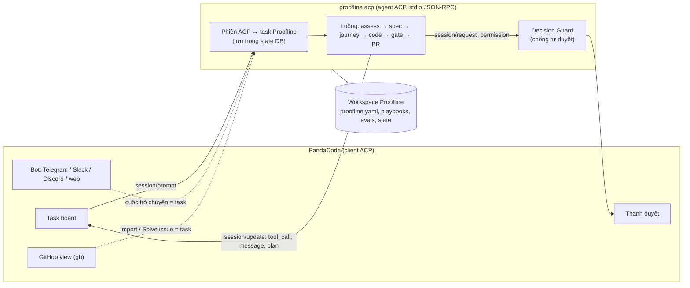

# Tích hợp Proofline qua ACP, với PandaCode làm giao diện

> **Mục tiêu:** người dùng làm việc với Proofline từ một giao diện có sẵn — task board, thanh duyệt, bot Telegram/Slack/Discord, xem GitHub — mà Proofline không phải tự xây những thứ đó, và **không đánh đổi nguyên tắc nào** của Proofline (gate do harness thực thi, quyền tự chủ kiếm bằng số liệu, quyết định thiết kế luôn do người).
>
> **Cách làm:** Proofline trở thành một **agent ACP** (`proofline acp`). [PandaCode](https://github.com/aicodeking/pandacode) là client ACP đầu tiên; mọi client ACP khác dùng được cùng một bản.
>
> Liên quan: [03-system-architecture.md](03-system-architecture.md) · [04-execution-plan.md](04-execution-plan.md) · [05-starting-points.md](05-starting-points.md) · [06-the-outer-loop.md](06-the-outer-loop.md)

---

## 1. Bối cảnh và quyết định

**PandaCode** (đọc mã nguồn bản 0.3.21, 2026-10-22) là ứng dụng desktop (Tauri, Rust + TypeScript; macOS, Windows, Linux) chạy nhiều coding CLI song song: Claude Code, Codex, Kimi, OpenCode và các agent nói ACP. Có sẵn: task board, thanh duyệt, bot, GitHub view, worktree theo task, nhóm architect + workers. Chạy cục bộ, không telemetry. Giấy phép MIT kèm điều kiện fork phải ghi "This is a fork of PandaCode".

| Phương án | Kết luận |
| :--- | :--- |
| **A. Proofline là agent ACP** | **Chọn.** Chuẩn mở, không khóa vào một client; Proofline giữ quyền điều khiển gate và quyết định |
| B. Fork PandaCode thành "Proofline Desktop" | Không. Codebase lớn, upstream ra nhiều bản mỗi ngày nên merge rất tốn; bắt buộc ghi nhận fork; lẫn bản sắc sản phẩm |
| C. Proofline là MCP server cho Claude Code gọi | Không làm đường chính. Coding agent cầm lái, gate thành "tool agent có thể không gọi", trái nguyên tắc "thực thi bằng harness" |

**Rủi ro phụ thuộc:** PandaCode mới vài ngày tuổi, gần như một người duy trì. Phương án A giảm rủi ro này: nếu PandaCode đổi hướng, Proofline vẫn chạy với client ACP khác, với CLI và bản tin của chính nó.

---

## 2. Kiến trúc



- PandaCode khởi chạy `proofline acp --workspace <thư mục workspace>`, nói JSON-RPC qua stdio.
- **Mỗi lượt (turn) là một tiến trình:** PandaCode đóng tiến trình khi lượt xong và mở lại cho lượt sau (resume phiên). Proofline phải lưu ánh xạ `phiên ACP ↔ task Proofline` trong `state/proofline.db` và hỗ trợ `session/load`; không giữ việc chạy nền giữa hai lượt.
- PandaCode gửi `clientCapabilities: {}` (không cho agent đọc/ghi file qua client): Proofline tự làm việc với file trong thư mục được giao, như mọi CLI khác.

---

## 3. Ánh xạ khái niệm

### 3.1. Phiên và repo đích

| ACP | Proofline |
| :--- | :--- |
| `session/new { cwd }` | Tìm repo đích có `local_path` trùng git toplevel của `cwd` (hoặc `cwd` là worktree của repo đó). Không thấy → đề xuất `proofline target add <cwd>` qua thanh duyệt |
| `session/prompt` | Một bước của task: nhận yêu cầu, chạy tới điểm cần người quyết hoặc tới khi xong |
| `session/load` | Nạp lại task từ state DB (spec, journey đã duyệt, gate đã chạy) |
| `session/cancel` | Dừng gate đang chạy, dọn tiến trình con (`kill_tree`), ghi `aborted` |
| Kết thúc lượt (`stopReason: end_turn`) | Proofline đang chờ người (vd chờ duyệt spec) hoặc đã xong |

### 3.2. Task board

| Cột PandaCode | Ý nghĩa với Proofline |
| :--- | :--- |
| Pending | Issue đã nhập / việc đã tạo, chưa chạy |
| In progress | Lượt Proofline đang chạy (assess, viết spec, code, gate) |
| Review | Lượt kết thúc: chờ người duyệt (spec, thay đổi journey) **hoặc** PR draft đã mở chờ review |
| Completed | Người đánh dấu xong (PR đã merge hoặc dừng việc) |

Trạng thái chi tiết của Proofline (spec đã duyệt, từng gate) hiện **trong luồng hội thoại**, không thành cột riêng. Tiêu đề lượt cuối luôn nêu rõ "đang chờ gì" để người nhìn board biết việc ở cột Review cần làm gì.

### 3.3. Báo cáo tiến độ và gate

| Sự kiện Proofline | `session/update` |
| :--- | :--- |
| Kế hoạch của task | `plan` (danh sách bước: assess → spec → journey → code → gate → PR) |
| Chạy một gate (vd `acceptance_fails_before`) | `tool_call` kind `execute`, tiêu đề "Gate: …", trạng thái `in_progress` → `completed` / `failed`, nội dung là tóm tắt kết quả |
| Spec, patch journey, diff code | Nội dung `diff` (path, oldText, newText) trong tool call |
| Ảnh bằng chứng giao diện | Link file trong `.proofline/evidence/` (kênh chat chỉ nhận chữ) |
| Tóm tắt cuối lượt | `agent_message_chunk` (bảng gate như trong PR) |

### 3.4. Slash command

Proofline công bố qua `available_commands_update`:

| Lệnh | Việc |
| :--- | :--- |
| `/assess` | Đo mức sẵn sàng của repo của phiên (thêm `--run` để chạy lệnh) |
| `/spec` | Viết hoặc xem spec + acceptance journey của task |
| `/gates` | Chạy lại toàn bộ gate, so với baseline |
| `/status` | Trạng thái task: đang ở bước nào, đang chờ gì |
| `/teach <nguyên tắc>` | Dạy gu trực tiếp (vào `tech-lead-taste.md` qua quy trình taste) |
| `/approve`, `/reject <lý do>` | Duyệt / từ chối bằng chữ (đường thay thế cho thanh duyệt, xem 4.3) |

### 3.5. Thanh duyệt

Mỗi điểm người quyết là một `session/request_permission`, ghi vào bảng `decisions` (người trả lời, lựa chọn, thời gian phản hồi).

| Quyết định Proofline | Lựa chọn đưa ra | Ghi chú |
| :--- | :--- | :--- |
| `acceptance_approval` (spec + journey) | "Duyệt" · "Duyệt, có góp ý" · "Từ chối" | Kèm diff spec và journey |
| Thay đổi journey đã duyệt | "Duyệt thay đổi" · "Duyệt, có góp ý" · "Từ chối" | Kèm patch, lý do, kết quả chạy thử |
| `pr_ready_for_review` (mở PR draft) | "Mở PR draft" · "Mở PR, có góp ý" · "Chưa" | Kèm bảng gate |
| `target_add` (repo chưa có trong workspace) | "Thêm repo" · "Thêm, sửa cấu hình" · "Không" | Kèm cấu hình tự dò |
| `--run` lần đầu trên repo (chạy lệnh của repo trên máy) | "Cho phép lần này" · "Cho phép, xem lệnh trước" · "Không" | Cảnh báo chạy ngoài sandbox |

Lý do của mọi lựa chọn có hai `allow_once` nằm ở mục 4.1.

---

## 4. Giữ nguyên tắc của Proofline

### 4.1. Chế độ Full access không được tự duyệt thay người

**Vấn đề.** Task mới trong PandaCode mặc định ở **Full access**. Theo mã nguồn (`src-tauri/src/providers/acp.rs`), PandaCode **tự chọn `allow_once`** cho một yêu cầu ACP khi: chế độ là Full access (hoặc Auto và thao tác là sửa file), yêu cầu có **đúng một** lựa chọn `allow_once`, và không phải câu hỏi có cấu trúc. Nếu Proofline xin duyệt spec bằng một yêu cầu "Duyệt / Từ chối" thông thường, quyết định đáng lẽ luôn do người (mức trần L1) sẽ được **tự động chấp nhận**.

**Ba lớp phòng thủ:**

1. **Hình dạng lựa chọn.** Mọi quyết định của người đưa ra **hai lựa chọn `allow_once`** ("Duyệt" và "Duyệt, có góp ý"). Với hai lựa chọn, quy tắc tự duyệt hiện tại của PandaCode không áp dụng. Lựa chọn thứ hai còn hữu ích thật: sau khi chọn, Proofline hỏi góp ý bằng chữ ở lượt sau.
2. **Decision Guard trong Proofline** (không tin client):
   - Câu trả lời cho quyết định L1/L2 đến trong **dưới 2 giây** kể từ lúc gửi → coi là không có người, không áp dụng; Proofline hỏi lại bằng chữ (`/approve`).
   - Ghi `decided_by` và thời gian phản hồi vào `decisions`; quyết định bị nghi tự động bị gắn cờ trong digest.
3. **Chế độ phiên.** Proofline công bố các chế độ của mình (`default` = Standard, `plan`) qua ACP và **không công bố chế độ bỏ qua duyệt**. Client xin chuyển sang chế độ khác (vd `bypass` khi task ở Full access) thì Proofline trả lỗi; theo tài liệu PandaCode, đổi chế độ thất bại thì **dừng lượt** thay vì chạy tiếp dưới chế độ khác. Lượt đầu của mỗi phiên nhắc người dùng chọn Standard.

Lớp 1 dựa vào chi tiết cài đặt của PandaCode nên có thể đổi theo phiên bản; lớp 2 là lớp chắc chắn. Kiểm thử ở mục 7 phải tái hiện đúng quy tắc tự duyệt của client để giữ hai lớp này luôn đúng.

### 4.2. "Always allow" không phải đường tắt để nâng quyền tự chủ

**Vấn đề.** ACP có lựa chọn `allow_always`; trong bot của PandaCode, trả lời `always` **tạo luật tự duyệt** cho các lần sau. Nếu Proofline đưa lựa chọn này cho quyết định có mức trần thấp, người dùng bấm một lần là mất luôn bước người duyệt.

**Quy tắc:**

| Loại quyết định | Có đưa `allow_always` không |
| :--- | :--- |
| Mức trần L1/L2 (`spec_approval`, `acceptance_approval`, `architecture_choice`, `merge_logic_change`, `customer_reply`, `taste_or_playbook_update`) | **Không bao giờ** |
| Quyết định có thể lên L3+ (vd `retry_or_abort`, `pr_ready_for_review` khi đã đạt mức) | Có thể đưa, nhưng chỉ được **ghi nhận** như một lượt người đồng ý. Mức tự chủ vẫn do Autonomy Controller tính từ nhật ký (≥ 50 quyết định, độ khớp ≥ 95%, theo mức sẵn sàng). "Always" không tự nâng mức |
| Chạy lệnh của repo ngoài sandbox | Không |

Proofline không bao giờ coi một luật "always" phía client là quyền: mọi quyết định vẫn đi qua Decision Guard và bảng `decisions`.

### 4.3. Khi client không hiển thị được lựa chọn

PandaCode bản hiện tại chỉ hỗ trợ duyệt dạng có/không qua ACP; câu hỏi có cấu trúc và form chưa có. Vì vậy:
- **Lý do từ chối** (vd "sai hướng", "quá rộng", "sai style", "không cần") được hỏi **bằng chữ ở lượt sau** sau khi người chọn "Từ chối" hoặc "Duyệt, có góp ý".
- `/approve` và `/reject <lý do>` luôn dùng được như đường thay thế, kể cả từ kênh bot.
- Giao diện duyệt phong phú hơn (xem diff có chú thích, chọn lý do nhanh) là phần **đóng góp lên PandaCode** sau, không chặn tích hợp.

### 4.4. Tính năng của PandaCode đụng với Proofline

Đã đối chiếu mã nguồn PandaCode (commit `d462cfc`):

| Tính năng PandaCode | Đụng ở đâu | Cách xử lý |
| :--- | :--- | :--- |
| **Turn checks** (Settings → Agents, mặc định tắt): sau một lượt sạch, chạy test nhanh của repo; fail thì tự gửi prompt "Project checks failed after your last turn…" (`src/turn-checks.ts`) | Tin nhắn tự động này đến đúng lúc Proofline đang chờ lý do từ chối, có thể bị ghi thành **quyết định của người**. Với repo có test fail sẵn (tiniagent: 23) thì gần như chắc chắn xảy ra | Proofline nhận ra tin nhắn này, không coi là câu trả lời, câu hỏi vẫn chờ người. Hướng dẫn: **tắt turn checks** khi dùng Proofline; gate thật chạy bằng `/verify` |
| **Thư viện Skills/Rules** (`src-tauri/src/skills/adapter.rs`): kích hoạt thì ghi vào `.claude/skills/`, khối trong `CLAUDE.md` (Codex: `.codex/skills`, `AGENTS.md`), ở cấp người dùng (`~/.claude`) hoặc trong checkout | Worker Claude Code của Proofline tự đọc các file này: skill cấp người dùng luôn được nạp, skill cấp project được nạp khi worker chạy trong checkout đó. Harness thật của worker khi đó không do Proofline kiểm soát, kết quả Golden Set không tái lập được | Worker chạy cô lập (chỉ nạp harness của Proofline: guardrails, taste, playbook, kho tri thức), và `harness_version` là dấu vân tay của harness thực tế đã nạp ([03-system-architecture.md](03-system-architecture.md) mục 2.1, 2.5). Skill của PandaCode dành cho chat riêng của người dùng |
| **Usage ledger / limits** | Worker do Proofline khởi chạy, không qua PandaCode, nên chi phí của nó không hiện trong thống kê của PandaCode | Proofline tự ghi chi phí (bảng `runs`) và báo trong `/status`, digest |

---

## 5. Bot

Cuộc trò chuyện của bot PandaCode là một task bình thường với agent được chọn, nên đặt agent là Proofline là đủ.

| Nhu cầu Proofline | Dùng tính năng bot |
| :--- | :--- |
| Bản tin buổi sáng | Lịch của bot (hằng ngày 07:00) với prompt `/status` cho các task đang mở; trả lời gửi về kênh |
| Duyệt từ điện thoại | Yêu cầu duyệt được gửi về kênh; trả lời `yes` / `no`. Lựa chọn thứ hai ("có góp ý") và lý do từ chối trả lời bằng chữ |
| Kill switch | `/stop` trong kênh hoặc Pause trong app; Proofline nhận `session/cancel` và dọn tiến trình |
| Nhật ký | `bot_activity` của PandaCode + bảng `decisions` của Proofline |

**Giới hạn:**
- **Bot chỉ chạy khi PandaCode đang mở** trên máy. Chạy xuyên đêm vẫn dùng lịch của Proofline; bot chỉ là kênh báo và duyệt.
- **Chỉ có chữ:** ảnh bằng chứng gửi dạng link.
- **Không thu tín hiệu Outer Loop** (error tracker, ticket): phần đó vẫn do Proofline (Phase 7). Tin nhắn từ kênh là dữ liệu không đáng tin, đúng nguyên tắc ở [06-the-outer-loop.md](06-the-outer-loop.md).
- Trả lời `always` trong kênh khi yêu cầu không có lựa chọn `allow_always`: hành vi của PandaCode cần kiểm tra ở bước thử (mục 7, bước 5).

---

## 6. GitHub, worktree và merge

### 6.1. GitHub view

| Tính năng PandaCode | Dùng với Proofline |
| :--- | :--- |
| **Import from GitHub** (issue → task Pending) | Nguồn việc của Proofline. Khi nhập phải đặt agent là Proofline và chế độ **Standard** (mặc định của PandaCode là agent mặc định + Full access) |
| **Solve** (issue → thread sửa trên nhánh) | Một task Proofline loại `bug` hoặc `feature`. Khối "GitHub context" PandaCode gắn vào prompt được Proofline coi là **dữ liệu**, không phải lệnh |
| **Fix failing checks** | Task tự sửa CI fail (Phase 6) |
| `gh` đã đăng nhập của người dùng | Giải quyết việc đọc repo private khi người dùng tự thao tác. Proofline chạy nền vẫn cần token riêng (GitHub App) |

### 6.2. Ai làm chủ worktree

| Việc | Làm chủ | Cách làm |
| :--- | :--- | :--- |
| Thư mục làm việc của task | **PandaCode** | Proofline làm việc trong `cwd` của phiên (thường là worktree PandaCode tạo cho task); không tạo worktree riêng cho task khi chạy qua ACP |
| Chạy gate | **Proofline** | Container của Proofline gắn `cwd`; lệnh của repo không chạy trực tiếp trên máy khi đã có sandbox (Phase 1) |
| Baseline để so regression | **Proofline** | Bản clone riêng trong `<workspace>/repos/<tên>/`, **không** tạo worktree vào `.git` của người dùng (phát hiện số 7 của lần chạy thử 1) |
| Nhóm architect + workers | Không dùng cho task Proofline | Tránh hai hệ thống cùng điều phối một việc |

### 6.3. Ai làm chủ merge

| Cấp | Merge |
| :--- | :--- |
| Cấp 1 | **Người** bấm merge PR trên GitHub hoặc qua PandaCode ("Merge when ready" chỉ merge khi CI xanh và đã được duyệt) |
| Cấp 2 | **Autonomy Controller của Proofline**, qua GitHub API, chỉ vào `develop`/`staging`, đúng điều kiện ở [04-execution-plan.md](04-execution-plan.md) mục 3. Không đi qua nút của PandaCode |
| Không dùng | **"Merge into main"** (merge cục bộ của PandaCode) cho task Proofline: bỏ qua PR, CI và branch protection. Proofline không chặn được nút này, nên ghi rõ trong hướng dẫn và cảnh báo trong tóm tắt cuối lượt |

**PR:** Proofline tự mở PR draft (sau quyết định `pr_ready_for_review`) để nội dung PR có bảng gate và ảnh bằng chứng. Nút "Push & open pull request" của PandaCode lấy mô tả từ task nên thiếu bằng chứng. Việc PandaCode tự liên kết PR do Proofline mở với task cần kiểm tra ở bước thử.

---

## 7. Kế hoạch thử từng bước

| Bước | Việc | Tiêu chí đạt |
| :--- | :--- | :--- |
| **0. Dùng thử PandaCode** (người dùng) | Cài PandaCode, chạy Claude Code trên repo đích thử nghiệm: board, thanh duyệt, GitHub view, một bot web chat | Người dùng xác nhận trải nghiệm đủ tốt để làm giao diện chính |
| **1. Khung `proofline acp`** ✅ | `initialize`, `session/new`, `session/prompt`, `session/cancel`, `session/load`, `session/set_mode`; công bố slash command; ánh xạ `cwd` → repo đích; phiên lưu trong bảng `acp_sessions` | Bộ test giao thức với client JSON-RPC giả lập (pytest) đi qua đủ các bước; tiến trình mới mỗi lượt vẫn nối lại đúng task · **Đạt** (`tests/test_acp.py`, kể cả chạy `python -m proofline acp` thật qua stdio: chỉ JSON, UTF-8, không `\r`) |
| **2. Luồng chỉ đọc** 🟡 | `/assess`, `/status`: stream `tool_call` của từng tiêu chí | Chạy trong một client ACP có cấu hình agent tùy chỉnh; kết quả trùng `proofline assess` ở CLI · Đã kiểm bằng client giả lập; **chưa chạy trong client thật** |
| **3. Luồng có duyệt + Decision Guard** 🟡 | Duyệt spec bằng `request_permission` (hai `allow_once`), hỏi lý do bằng chữ, `/approve` / `/reject`; chạy `/verify` qua ACP | Test tái hiện đúng quy tắc tự duyệt của PandaCode ở Full access: **0 quyết định L1 được áp dụng tự động**; câu trả lời dưới 2 giây bị từ chối và ghi cờ; không lúc nào có `allow_always` cho quyết định mức trần L1/L2 · Đã kiểm bằng client giả lập (`tests/test_acp_decisions.py`, đồng hồ giả: người trả lời sau 5 giây, client tự chọn sau 0,3 giây); **chưa chạy trong client thật**. Chi tiết ở mục 7.2 |
| **4. Chạy trong PandaCode** | Trước mắt dùng **lệnh giả `command-code`** với bản PandaCode chính thức (mục 7.1). Lâu dài: bản build cục bộ có provider Proofline (đăng ký ở khoảng 15 chỗ trong `providers.rs` cùng giao diện chọn agent, nhiều hơn một file như ước tính ban đầu; cần Rust) hoặc tính năng upstream ở bước 6 | Làm lại một tính năng cỡ lần chạy thử đầu tiên trên repo đích thử nghiệm, hoàn toàn từ PandaCode: nhập issue → board → duyệt spec ở thanh duyệt → gate → PR draft. Ghi lại mọi chỗ vướng |
| **5. Bot** | Bot web chat (sau đó Telegram) với agent Proofline; lịch 07:00 `/status` | Bản tin đến đúng giờ; duyệt `yes`/`no` từ kênh được ghi vào `decisions`; `/stop` dừng gate và dọn tiến trình; kiểm tra hành vi khi trả lời `always` |
| **6. Đóng góp lên PandaCode** | Mở issue/PR "custom ACP agents" (khai báo lệnh, tham số, biến môi trường của một agent ACP tùy ý) thay vì giữ provider riêng | Proofline dùng được trong bản PandaCode chính thức mà không cần build riêng |

Bước 1–3 không phụ thuộc PandaCode và có thể làm ngay sau khi có worker (Phase 1); bước 2 làm được từ bây giờ vì `assess` đã có.

### 7.1. Thử ngay với bản PandaCode chính thức (lệnh giả, chỉ để thử)

PandaCode chạy agent "Command Code" bằng lệnh `command-code acp` tìm trên `PATH` (`src-tauri/src/providers/commandcode.rs`). Một lệnh giả cùng tên chuyển sang `proofline acp` là đủ để PandaCode nói chuyện ACP với Proofline, không cần build PandaCode:

```bat
@echo off
rem command-code.cmd: CHỈ ĐỂ THỬ Proofline trong PandaCode. Không dùng khi máy có Command Code thật.
uv run --project "<đường dẫn repo Proofline>" proofline %* --workspace "<thư mục workspace>"
```

1. Đặt file trên vào một thư mục trong `PATH` (vd `<workspace>/bin`, rồi thêm thư mục này vào `PATH` của người dùng) và khởi động lại PandaCode.
2. Trong PandaCode: mở repo đích như một project (**Open project** với thư mục có sẵn, hoặc **Clone to this computer** ở GitHub hub), chọn agent **Command Code**, chế độ **Standard**.
3. Gõ `/init` để đăng ký repo với workspace (lần đầu), rồi `/assess`, `/status`, `/spec`, `/verify` (xem mục 7.2).

**Lưu ý:**
- Giao diện vẫn hiện chữ "Command Code"; đó là tên của provider bị mượn, không phải Proofline.
- Ở Full access, PandaCode xin chế độ `bypass`; Proofline từ chối nên lượt dừng (đúng ý đồ ở mục 4.1).
- PandaCode đọc danh sách model từ `configOptions` của phiên; Proofline chưa công bố model nào nên ô chọn model có thể trống.
- Đây là mẹo tạm cho bước 4; đường chính thức vẫn là bước 6.

### 7.2. Luồng có duyệt đã làm (bước 3)

| Lệnh | Việc | Quyết định ghi vào `decisions` |
| :--- | :--- | :--- |
| `/init [tên] [--git-init]` | Đăng ký thư mục đang mở làm repo đích: tự dò stack và lệnh, chỉ ghi `targets/<tên>/target.yaml` trong workspace (repo không bị sửa), rồi chạy `/assess`. Mở từ thư mục con thì đăng ký gốc repo. Thư mục **trống** chưa có git (luồng khởi đầu từ ý tưởng): hỏi **Khởi tạo git (nhánh main)** / **Khởi tạo git + commit rỗng đầu tiên** / **Không**; gõ `--git-init` thì không hỏi. Thư mục **đã có file** mà chưa có git: không tự `git init`, chỉ hướng dẫn. Không `git init` ở chế độ Plan | `register_target`; `git_init` |
| `/spec [tên]` | Hiện spec, journey, lịch sử duyệt. Nếu journey chưa duyệt hoặc đã đổi sau lần duyệt: gửi `tool_call` có khối `diff` (bản đã duyệt → bản hiện tại) rồi `session/request_permission` với **Duyệt** (`allow_once`), **Duyệt, có góp ý** (`allow_once`), **Từ chối** (`reject_once`) | `acceptance_approval`, `decided_by='human'`; duyệt thì thêm một mục vào `journey_approvals` của spec |
| Tin nhắn kế tiếp | Sau "Duyệt, có góp ý" hoặc "Từ chối", Proofline hỏi góp ý / lý do; tin nhắn không bắt đầu bằng `/` ở lượt sau là câu trả lời (câu hỏi lưu ở bảng `acp_pending` vì mỗi lượt là một tiến trình mới). Gõ một lệnh khác thì bỏ câu hỏi | Nối vào `human_reason` của quyết định vừa ghi |
| `/approve [tên] [góp ý]`, `/reject [tên] <lý do>` | Đường bằng chữ. Người gõ lệnh nên không qua Decision Guard. Không ghi tên spec thì lấy spec duy nhất đang chờ duyệt | Như trên, kèm kênh `[lệnh /approve]` |
| `/verify [tên] [--runs N] [--no-install]` | Xin phép chạy lệnh của repo (**Chạy verify**, **Chạy nhanh: 1 lượt, không cài lại**, **Không chạy**), rồi chạy các gate: mỗi giai đoạn là một `tool_call` `execute`, mỗi gate một `tool_call` có kết quả; cuối cùng gửi bảng báo cáo và ghi `verify/<spec>.md|json`. Từ chối ở chế độ Plan. `--yes` (người gõ) bỏ qua câu hỏi | `run_repo_commands` |

**Decision Guard:** lựa chọn kiểu `allow` đến sớm hơn `acp.decision_guard_seconds` (mặc định 2 giây) kể từ lúc hỏi thì **không áp dụng**, ghi `decided_by='agent'`, `agent_choice='client_auto_suspected'` kèm thời gian, và nhắn người dùng gõ lệnh bằng chữ (`/approve <tên>` hoặc `/verify <tên> --yes`). Từ chối nhanh vẫn được tôn trọng: dừng lại không bao giờ nguy hiểm. Huỷ (`session/cancel`) trong lúc chờ thì không ghi quyết định nào.

**Giới hạn hiện tại:**
- `/spec` chỉ xem và duyệt spec đã có trong `.proofline/specs/`; viết spec từ yêu cầu bằng lời là bước sau (cần worker).
- Trong lúc `/verify` chạy, agent không đọc stdin nên `session/cancel` chỉ có tác dụng khi verify xong. Dừng giữa chừng cần tách luồng đọc, làm cùng bot `/stop` ở bước 5.
- Lệnh của repo chạy trực tiếp trên máy (chưa có sandbox); câu hỏi xin phép nói rõ điều này.

---

## 8. Câu hỏi còn mở

1. Client ACP thứ hai để thử bước 2–3 (cần hỗ trợ khai báo agent ACP tùy chỉnh): chọn client nào.
2. PandaCode có tự liên kết PR do Proofline mở (không qua nút của PandaCode) với task không; nếu không, có nên đề xuất upstream.
3. Có nên đề xuất upstream để task gắn với một agent ACP cụ thể **không được** mặc định Full access.
4. Truy cập từ xa (relay) của PandaCode: tắt cho repo của công ty, hay cho phép với điều kiện nào.
5. Tạo project trong PandaCode: hiện có **Open project** (thư mục bất kỳ) và **Clone to this computer** (chỉ GitHub, qua `gh`). Thiếu clone từ git URL bất kỳ (GitLab nội bộ…) và tạo project trống; đề xuất upstream cùng issue ở bước 6 thay vì sửa giao diện trong bản riêng. Trước mắt: `proofline start <url>` ở CLI rồi Open project, hoặc tạo thư mục trống, Open project rồi `/init`.
