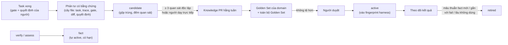

# Kho tri thức theo domain: tự cải thiện, nhưng phải chứng minh

> **Mục tiêu:** sau mỗi việc, Proofline biết thêm về repo và vùng code nó vừa làm (cách chạy, bẫy, test chập chờn, quy ước, script trợ giúp), và việc sau ở cùng domain làm nhanh hơn, đúng hơn. Ý tưởng lấy từ "harnessing-level recursion" của Harness² ([01-research-harness2.md](01-research-harness2.md) mục 5), nhưng **không tự áp dụng**: mỗi bài học phải có bằng chứng, qua bộ đo và được người duyệt như mọi thay đổi harness khác.

---

## 1. Khác gì với taste, playbook và Harness²

| | Nội dung | Phạm vi | Ai quyết cho dùng |
| :--- | :--- | :--- | :--- |
| `tech-lead-taste.md` | Gu: người quyết định thế nào và vì sao | Cả dự án / từng người review | Người, sau Decision Replay Set + Golden Set |
| `playbooks/skills/` | Quy trình chung theo loại task (bug-fix, feature…) | Mọi repo | Người, sau Golden Set |
| **Kho tri thức** (tài liệu này) | Sự thật và bài học kỹ thuật **gắn với một domain** | Repo / vùng code / stack | Sự thật đo được: tự động. Bài học: người, sau Golden Set của domain |
| Thư viện của Harness² | Nguyên cây harness được chọn + `EXPERIENCE.md` | Một domain, **trống lại mỗi lượt chạy** | Tự áp dụng, không qua bộ đo, không qua người |

Bài học về **gu** (vd "không thêm dependency cho việc nhỏ") đi vào taste; bài học về **code** (vd "vùng `src/browser/` phải dựng agent riêng trong test vì agent seed dùng chung") đi vào kho tri thức. Lead Agent phân loại khi ghi nhận.

---

## 2. Domain trong Proofline

Harness² chia domain theo nghề (luật cạnh tranh, kế toán…). Với phần mềm, domain là nơi tri thức còn đúng:

| Cấp | Ví dụ | Dùng khi |
| :--- | :--- | :--- |
| `stack/<stack>` | `node-pnpm-vitest`, `python-uv-pytest` | Mọi repo cùng stack (cần ≥ 2 repo để được nâng lên cấp này) |
| `repo/<repo>` | `tiniagent`: cả bộ test phụ thuộc thứ tự; `pnpm lint` hỏng sẵn trên base | Mọi việc trên repo đó |
| `repo/<repo>/area/<area>` | `tiniagent/area/browser`: kịch bản cần agent riêng và dọn dẹp | Việc chạm vào vùng đó |

**Vùng (area)** khai báo trong `knowledge/repo/<repo>/areas.yaml` (đường dẫn → tên vùng), bootstrap từ thư mục cấp đầu, `CODEOWNERS` hoặc `affected_area` của triage; người chỉnh được.

**Lấy theo cấu trúc, không tìm kiếm mờ** (như Harness²): việc chạm vào file nào thì nạp `stack` + `repo` + các `area` tương ứng. Nạp **nguyên văn** các mục `active`, có giới hạn dung lượng (`knowledge.load.max_chars`); vượt giới hạn thì báo trong trace, không âm thầm cắt.

---

## 3. Loại mục và độ tin

| Loại | Nguồn | Ví dụ | Vào ngữ cảnh worker khi |
| :--- | :--- | :--- | :--- |
| **fact** (đo được) | `proofline verify`, `assess`, CI | "23 test fail sẵn trên `origin/dev` @ `28e1613`", "`pnpm lint` exit 2 trên base" | Ngay, vì là số đo có bằng chứng máy. Gắn commit đo; **hết hạn** khi base đổi hoặc lần đo mới mâu thuẫn |
| **lesson** (rút ra) | Phản tư cuối task (worker/Lead Agent), lý do duyệt/từ chối, chỉnh sửa của người trước merge | "Journey ở vùng browser phải tự tạo agent và dọn site đã mở (journey v1 bị từ chối vì dùng agent seed)" | Chỉ khi `active` |
| **script** | Script trợ giúp worker tự viết trong task, dùng lại được | `scripts/reset-browser-state.ts` | Chỉ khi `active` **và** tự chạy được trong sandbox |
| **pitfall** | Gate fail lặp lại, lý do từ chối lặp lại | "Đừng sửa `e2e/journeys/*` sau khi duyệt: gate `acceptance_unchanged`" | Chỉ khi `active` |

Mỗi mục là một file có frontmatter:

```yaml
id: tiniagent-browser-own-agents
domain: repo/tiniagent/area/browser
kind: lesson                      # fact | lesson | script | pitfall
status: candidate                 # candidate → active → retired
statement: "Kịch bản người dùng ở vùng browser phải tự tạo agent và dọn site đã mở."
applies_when: "Viết hoặc sửa journey chạm src/browser/**"
evidence:                         # Bắt buộc ≥ 1; link tới bằng chứng thật
  - { type: decision, ref: "decisions/<id>", note: "journey v1 bị từ chối" }
  - { type: verify, ref: ".proofline/verify/browser-activity-log.json" }
observations: 1                   # Số task độc lập quan sát thấy
born_from: { task: "<task-id>", golden_case: null }
stats: { loaded: 0, tasks_passed_first_try: 0, tasks_failed: 0 }
```

---

## 4. Vòng đời



1. **Ghi nhận:** cuối mỗi task, worker hoặc Lead Agent đọc một **cây bằng chứng dạng file** (ý tưởng `context.py` của Harness²: task, trajectory, kết quả gate, diff, quyết định của người) và đề xuất mục mới hoặc tăng `observations` cho mục đã có. Mục không có bằng chứng bị loại.
2. **Sự thật đo được** từ `verify`/`assess` ghi thẳng vào `facts.yaml` kèm commit và báo cáo nguồn.
3. **Nâng lên `active`** (bài học, script, bẫy): đủ `knowledge.promotion.min_observations` quan sát từ các task **khác nhau**, hoặc người dạy trực tiếp (`/proofline teach --domain …`). Đề xuất gom thành **một PR mỗi tuần** vào kho tri thức của workspace, kèm:
   - kết quả Golden Set **của domain** (case chạm vào vùng đó) và toàn bộ Golden Set: không được giảm;
   - với script: chạy được trong sandbox, có test.
   Người duyệt từng mục (quyết định `knowledge_update`, trần L2 như `taste_or_playbook_update`).
4. **Rút khỏi `active`:** fact mới mâu thuẫn, base đổi làm fact hết hạn, mục gắn với tỷ lệ fail cao hơn khi được nạp, hoặc không được dùng trong `knowledge.retire.unused_tasks` task. Rút là tự động nhưng báo trong digest.

---

## 5. Đo "tự cải thiện"

* **Golden Set theo domain:** mỗi case gắn `domain`; pass@1 báo theo domain. Một thay đổi kho tri thức chỉ được nhận khi pass@1 của domain đó **không giảm** và toàn bộ Golden Set **không giảm**.
* **Chỉ số vận hành theo domain:** tỷ lệ pass gate ngay lần đầu, số lần làm lại, loại gate fail lặp lại, thời gian và chi phí mỗi task. Mục tiêu: các chỉ số này tốt lên theo số task đã làm ở domain.
* **Propose–Probe–Compose offline** (từ Harness², Phase 5 trở đi): với một domain có ≥ 5 case Golden Set, agent đề xuất vài biến thể kho tri thức, chạy lại các case đó, **chọn bằng gate thật** (không dùng LLM chọn), ghép bản tốt nhất thành Knowledge PR. Chạy theo lịch, có ngân sách riêng, **không chạy cho mọi issue** (Harness² tốn ≥ 4 lần chạy + 3 phiên cải tiến cho mỗi task).

---

## 6. An toàn

* **Không rò rỉ đáp án:** mục sinh ra từ một lần chạy Golden Set ghi `born_from.golden_case`; khi chấm lại chính case đó, mục này **không được nạp**. Kho tri thức không bao giờ chứa nội dung `hidden_tests` (kiểm tra như `assert_no_leak_paths` của Harness²).
* **Tái lập được:** tập mục `active` đã nạp là một phần của dấu vân tay `harness_version` ([03-system-architecture.md](03-system-architecture.md) mục 2.1).
* **Không ra lệnh cho agent:** mục là dữ liệu mô tả repo, có giới hạn độ dài. Nội dung từ bên ngoài (khách hàng, kênh chat) chỉ vào qua Reader Agent theo schema ([06-the-outer-loop.md](06-the-outer-loop.md)); mục mâu thuẫn với `guardrails.md` bị loại tự động.
* **Không sửa repo đích:** kho tri thức nằm trong **workspace** (`<workspace>/knowledge/`), có git riêng để review bằng PR. Không ghi vào `CLAUDE.md`, `.claude/skills` hay bất kỳ file nào của repo; không đẩy vào thư viện Skills của PandaCode (xem [07-acp-pandacode.md](07-acp-pandacode.md) mục 4.4).

---

## 7. Lưu trữ

```text
<workspace>/knowledge/
├── INDEX.md                          # Tự sinh: mục active theo domain
├── stack/<stack>/{lessons,pitfalls,scripts}/
└── repo/<repo>/
    ├── INDEX.md
    ├── areas.yaml                    # Đường dẫn → vùng
    ├── facts.yaml                    # Sự thật đo được, gắn commit và báo cáo nguồn
    ├── {lessons,pitfalls,scripts}/
    └── area/<area>/{lessons,pitfalls,scripts}/
```

Trạng thái `candidate` và số liệu dùng (`stats`) cập nhật thường xuyên nên ở DB (`state/proofline.db`), file trong git chỉ giữ mục `active` và `retired` để review được. Quyết định nâng/rút ghi vào bảng `decisions`.

---

## 8. Lộ trình

| Bước | Việc | Cần có trước | Tiêu chí đạt |
| :--- | :--- | :--- | :--- |
| **K0. Sự thật đo được** ✅ | `verify`/`assess` ghi `facts.yaml` (test fail sẵn, lệnh hỏng trên base, thứ tự test…); `proofline knowledge show`; `/status` hiện các fact của repo | Đã có `verify`, `assess` | Chạy lại `verify` trên tiniagent sinh đúng các fact đã biết bằng tay; fact hết hạn khi base đổi |
| **K1. Worker nạp kho tri thức** | Nạp `active` theo domain, có giới hạn dung lượng, vào fingerprint harness | Worker (Phase 1) | Trace ghi rõ mục nào được nạp; chạy lại cùng fingerprint ra cùng tập mục |
| **K2. Ghi nhận và Knowledge PR** | Phản tư có bằng chứng → `candidate`; gộp trùng; PR hằng tuần qua Golden Set của domain; duyệt qua digest/ACP | Golden Set, Lead Agent (Phase 4) | 0 mục `active` thiếu bằng chứng hoặc chưa qua Golden Set |
| **K3. Propose–Probe–Compose offline** | Tối ưu kho tri thức của một domain trên Golden Set, chọn bằng gate | Golden Set theo domain ≥ 5 case/domain (Phase 5) | pass@1 của domain tăng vượt mức dao động so với trước |
| **K4. Tri thức theo stack** | Nâng mục giống nhau ở ≥ 2 repo lên `stack/<stack>` | ≥ 2 repo đích cùng stack | Repo mới cùng stack đạt gate lần đầu tốt hơn repo đầu tiên |

---

### 8.1. Bước K0 đã làm

`src/proofline/knowledge.py`. `proofline verify` (CLI và `/verify` qua ACP) và `proofline assess --run` ghi vào `<workspace>/knowledge/repo/<repo>/facts.yaml`:

| Nguồn | Sự thật (id) | Khi nào ghi / rút |
| :--- | :--- | :--- |
| `verify` (về **base**) | `tests.preexisting_failures` | Test fail ở **mọi** lượt trên base; rút khi đo lại không còn |
| | `tests.unstable_on_base` | Test fail ở **một số** lượt trên base (phụ thuộc thứ tự / trạng thái giữa các lượt) |
| | `static.<lệnh>.broken` | Typecheck/lint không chạy được trên base; chỉ đo khi nhánh không sạch (nhánh sạch thì base không được chạy nên giữ nguyên) |
| | `static.<lệnh>.baseline` | Số dòng lỗi/cảnh báo có sẵn trên base |
| | `install.broken` | `commands.install` lỗi trên base |
| | `journey.inconclusive_on_base` | Journey trên base fail **không ở khẳng định** (timeout, môi trường) ở một số lần chạy, kể cả khi lần chạy lại cho kết quả rõ; cộng dồn số lần chạy, số lần chạy lại và nguyên nhân trên cùng commit |
| `assess --run` (về checkout đang đo) | `<tiêu chí>.ok` / `.fails` | Container build, lệnh test, app khởi chạy, CI; kết quả `unknown` là chưa đo nên không ghi |

- **Cộng dồn trên cùng commit:** kết quả test của base qua nhiều lần đo được gộp (mục `observations` trong facts.yaml). Một test chỉ là "fail sẵn" nếu fail ở **mọi** lượt của **mọi** lần đo; fail ở lượt nào đó thì là "không ổn định". Một lần đo một lượt không đo được độ ổn định nên không rút sự thật về nó. Commit base mới thì đo lại từ đầu.
- Nguyên nhân công cụ hỏng lấy từ output của chính base, đường dẫn checkout thay bằng `<repo>`.
- Mỗi sự thật có `scope` (ref + commit đã đo), số lần đo, lần đo gần nhất và bằng chứng (báo cáo verify hoặc snapshot assess).
- **Hết hạn:** mỗi lần đọc hoặc ghi, ref được phân giải lại; trỏ sang commit khác thì `expired` ("cần đo lại"). Đo lại thì trở về `active`.
- **Rút:** đo lại mà điều kiện không còn thì `retired` kèm commit đã đo lại. Thứ không được đo trong lần này thì giữ nguyên.
- Xem bằng `proofline knowledge show [repo] [--all]`; `/status` qua ACP hiện tối đa 5 sự thật đang dùng.
- Chưa nạp vào worker (bước K1).

**Thử trên tiniagent** (base `origin/dev` @ `28e1613`, nhánh `feat/full-flow`): hai lần `verify` ghi lại đúng hai điều đã biết từ lần chạy tay: test không ổn định trên base (lần 1: 0 rồi 23 test fail; lần 2: 1 rồi 2) và `pnpm lint` hỏng sẵn (thiếu `eslint-config-next`). `assess --run` thêm: không có container, `pnpm test` chạy được (94 giây), app khởi chạy ở :3200, chưa có CI. Chính lần thử này cho thấy cần cộng dồn: lần đo thứ hai đã ghi đè "23 test" thành "3 test". Lần đầu, journey trên base còn fail vì hook timeout (không ở khẳng định); từ đó `verify` chạy lại journey trên base trước khi kết luận và ghi `journey.inconclusive_on_base`. Ở lần thử sau khi sửa, journey fail đúng ở khẳng định ngay lần đầu nên không phải chạy lại; đường chạy lại được kiểm bằng test với một journey chập chờn thật (`tests/test_verify.py`).

## 9. Câu hỏi còn mở

1. Độ mịn của vùng: theo thư mục cấp đầu là đủ, hay cần theo module/tính năng.
2. `min_observations` = 3 như taste có quá chậm với repo nhỏ, ít việc không.
3. Có xuất (export) mục `active` sang thư viện Skills của PandaCode cho các phiên chat riêng của người dùng không, và khi đó ai giữ bản gốc.
